# Cloth Craft Studio V2

**Professional garment design, from pattern to production.** A developing open-source workspace for **fashion designers, apparel brands, pattern makers, technical designers and manufacturers**. The goal is to connect drafting, grading, digital sewing, 3D garment design, fabrics, technical packages and production exports within a single editable garment project—rather than passing inconsistent information between separate applications.

The public source repository is still named `exo-sample-3d` for historical reasons. **Cloth Craft Studio V2 is the garment-design application shown here**; the independent Rust [ClothCraft project by erythrofr](https://github.com/erythrofr/ClothCraft) is a separate upstream effort we are studying for integration.

**Development status:** This is real, working research software with functional UI, drafting tools and selected export workflows. **It is not yet a certified commercial garment-fit simulator or a factory-approved pattern system.** Screenshots show the actual application at documented development dates, not a promise that every visible control is supported by the downloadable beta.

[**Watch the complete 7:24 studio walkthrough**](https://exo-clothcraft-video.vercel.app/) · [**Download the experimental macOS beta**](https://github.com/mikristian/exo-sample-3d/releases/tag/v0.3.0-beta.1) · [**Explore the feature gallery**](#explore-the-application) · [**Run from source**](#quick-start) · [**Development status**](#what-works-and-whats-still-in-development)

## Watch the full Studio V2 UI walkthrough

**[Play the 7-minute, 24-second UI tour](https://exo-clothcraft-video.vercel.app/)** · [Open the MP4 directly](https://exo-clothcraft-video.vercel.app/exo-studio-tour.mp4)

Recorded **October 29, 2026**, from a real development build. The tour covers the grading board, pattern drawing, measurement tools, split 2D/3D workspace, tech-pack screens, multi-piece layouts and studio customization. The recording is hosted separately to keep the source checkout lightweight. It documents UI states and workflows—not validated drape or factory-cut acceptance.

---

## Explore the application

**Jump to:** [Studio](#01-main-studio-2d-and-3d) · [2D patterns](#02-pattern-drafting) · [Grading](#03-grading-and-measurements) · [3D/cloth](#04-3d-garment-construction-and-simulation) · [Sewing](#05-digital-sewing-and-construction) · [Fabrics](#06-fabrics-materials-and-hardware) · [Tech packs](#07-technical-packages-and-production-engineering) · [Manufacturing](#08-manufacturing-exports-and-factory-handoff) · [Rendering](#09-render-studio-and-digital-clothing) · [Progress](#what-works-and-whats-still-in-development)

### 01 Main studio 2D and 3D

The main interface brings together a **3D avatar/garment viewport**, an editable **2D drafting board**, garment/file library and property inspector. Users can see how garment pieces are organized while navigating drafting and visualization within the same workspace. View selection, library management and property panels are implemented; exact physics fit is still an engineering goal.

[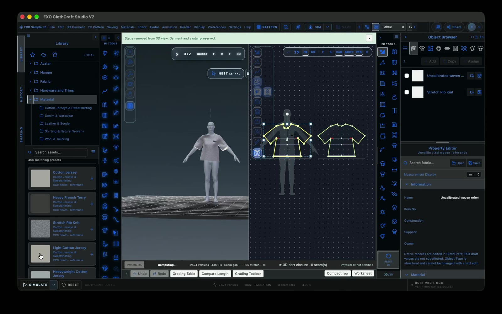](docs/gallery/2026-11/07-studio-overview.jpg)

*October 29 development recording — the real linked studio, not a concept mockup.*

| Earlier complete studio layout | Garment asset library and project controls |
| :---: | :---: |
| [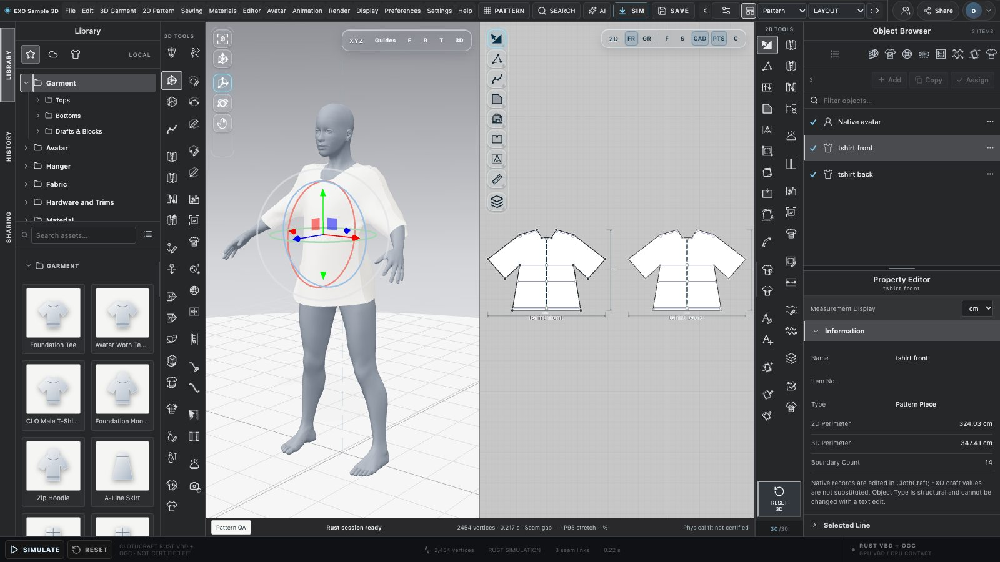](screenshots/clothcraft-v2-20261019-01-overview.jpg) | [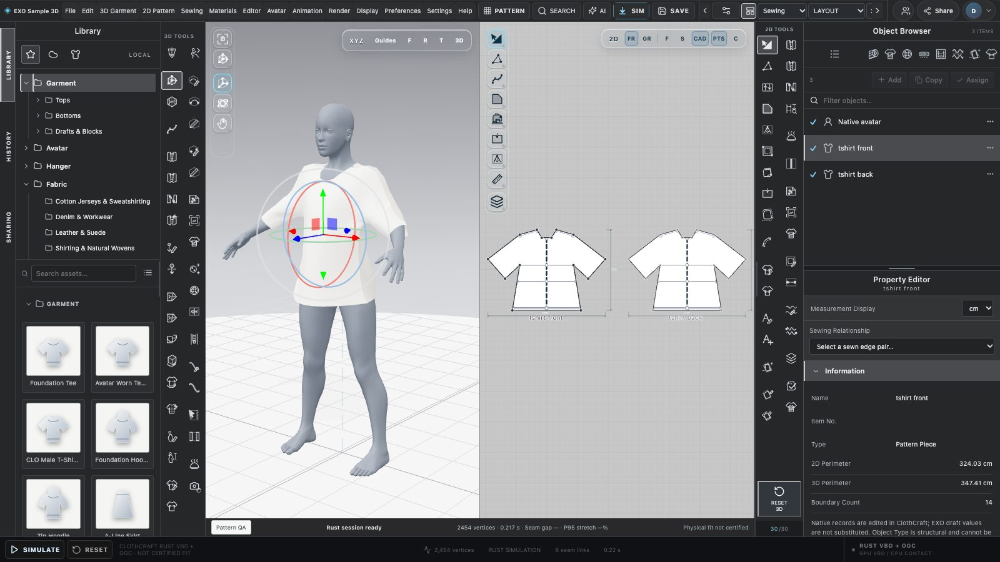](screenshots/clothcraft-v2-20261019-06-garments.jpg) |

### 02 Pattern drafting

The 2D CAD surface includes editable polygon/curve geometry, points, measurements, internal construction lines, grain direction, notches, seam allowance concepts, splitting, unfolding and alignment/snapping tools. These are working drafting implementations with regression tests; **industrial topology and arbitrary DXF round trips still need broader verification**.

| Real drafting and editing | Linked pattern selection and dimensions |
| :---: | :---: |
| [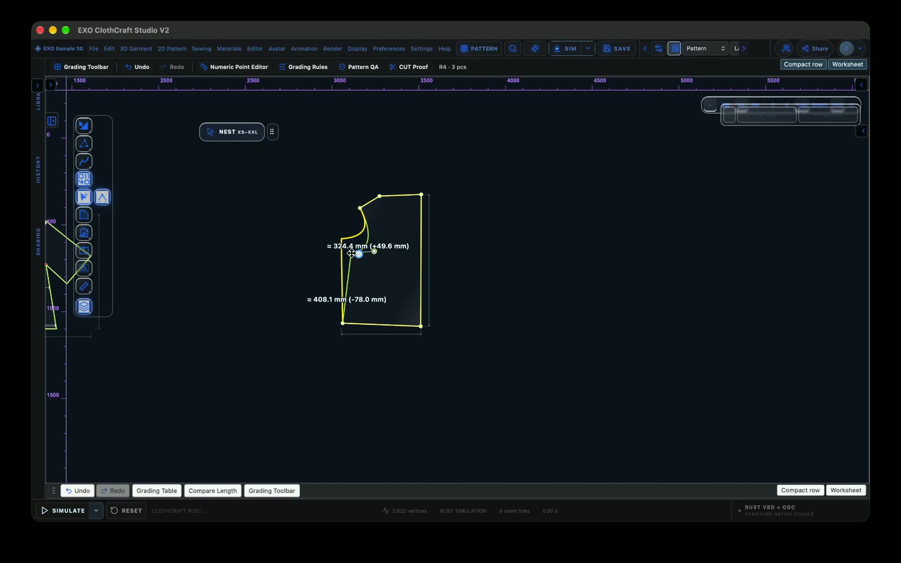](docs/gallery/2026-11/02-pattern-drafting.jpg) | [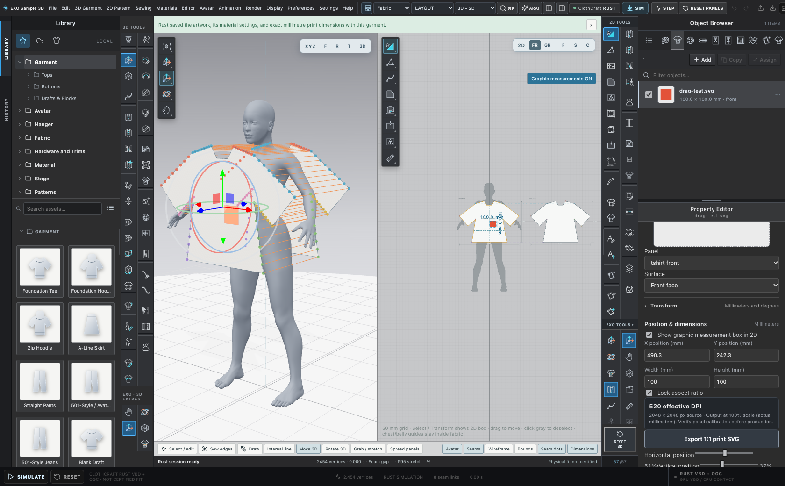](docs/gallery/2026-11/10-2d-measurements.png) |

### 03 Grading and measurements

Size-related pattern data, grading operations, point-of-measurement (POM) tools and garment dimensions already exist. The goal is a reliable multi-size drafting and validation workflow that feeds both garment simulation and accurate cutting documentation. **Rule-file interchange and complete production grading sign-off remain incomplete.**

| Development grading board and comparison | Grading-tool editor |
| :---: | :---: |
| [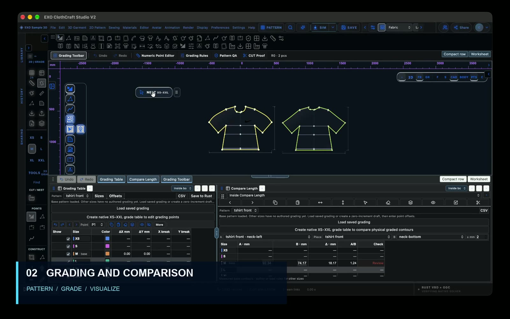](docs/gallery/2026-11/01-size-grading.jpg) | [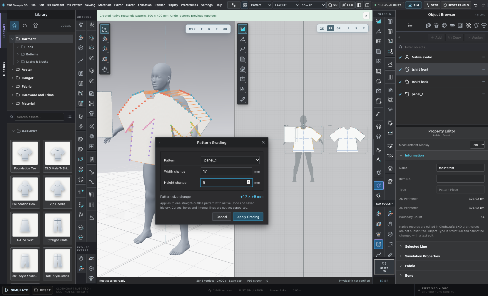](docs/gallery/2026-11/09-grading-widget.png) |

### 04 3D garment construction and simulation

The 3D viewport links patterns to garment panels and avatars for positioning, materials and iterative visual checks. Cloth Craft has **browser dynamics, experimental native C++/XPBD paths and an optional separate Rust PPF research connector**. Stable physically calibrated draping, self-collision, body contact and real-world fit validation remain open; a viewport image is not a certified simulated fit.

| Live split 2D/3D garment scene | 3D render workspace |
| :---: | :---: |
| [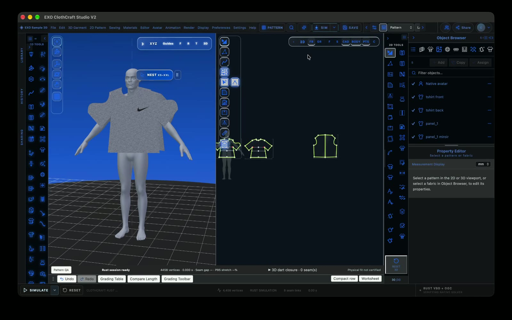](docs/gallery/2026-11/03-linked-2d-3d.jpg) | [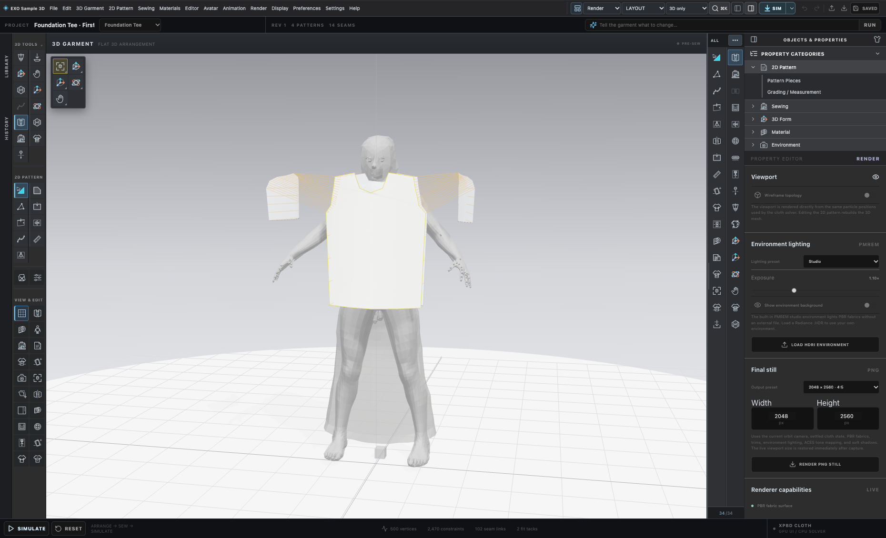](screenshots/exo-2026-3d-render-studio.png) |

[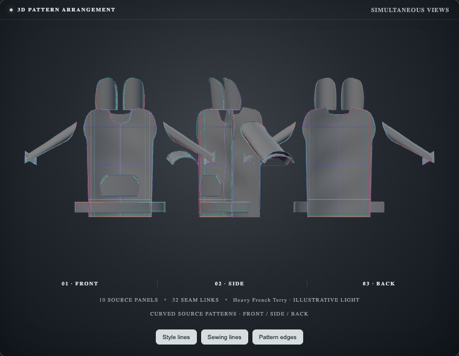](docs/gallery/2026-11/11-hoodie-panel-arrangement.png)

*Hoodie construction staging — an experimental garment-panel preview, not a claim of completed fabric fit.*

### 05 Digital sewing and construction

Drafted edges can be related through sewn boundaries, seam directions and full/partial-edge correspondence. There are experiments for easing, gathering and elastic assembly. The sewing workspace and inspection tools are usable development surfaces; advanced seam/contact physics and sewing semantics are still under test.

| Sewing interface and edge inspector | 2D/3D sewing workspace |
| :---: | :---: |
| [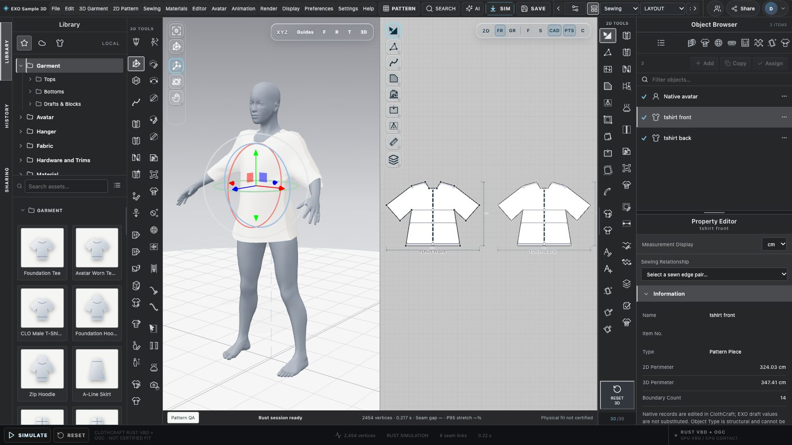](screenshots/clothcraft-v2-20261019-03-sewing.jpg) | [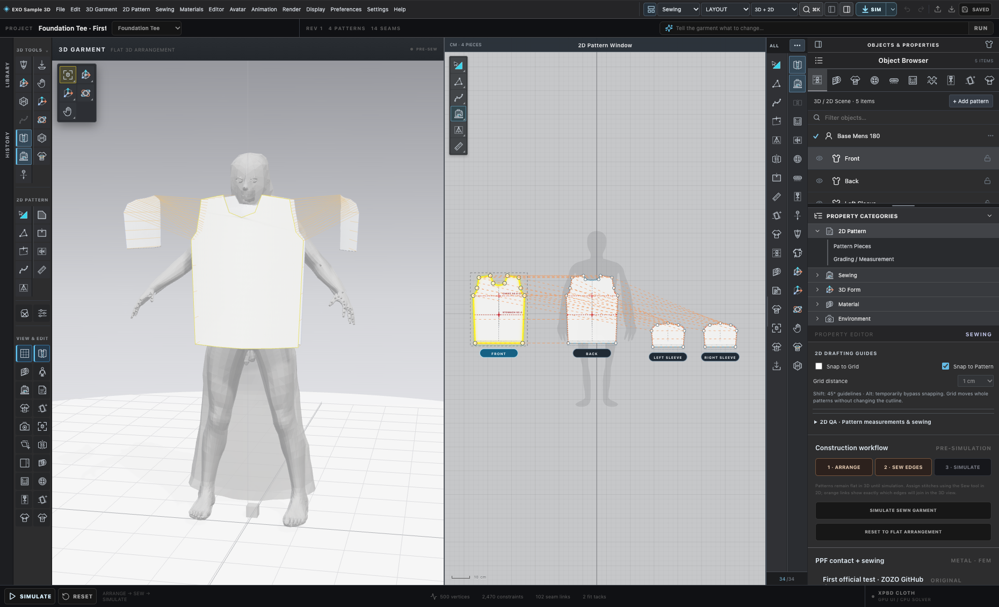](screenshots/exo-2026-sewing-workspace.png) |

### 06 Fabrics materials and hardware

Cloth Craft offers fabric presets, material assignments, texture maps and weave visualization, with PBR-style surface controls such as roughness, normal detail and shading. Fabric appearance and physical bending/stretch calibration are different problems; current visual swatches should not be mistaken for measured textile test results. Garment-library, trim and hardware browsers are part of the studio interface.

| Fabric/material library | Trims and hardware tree |
| :---: | :---: |
| [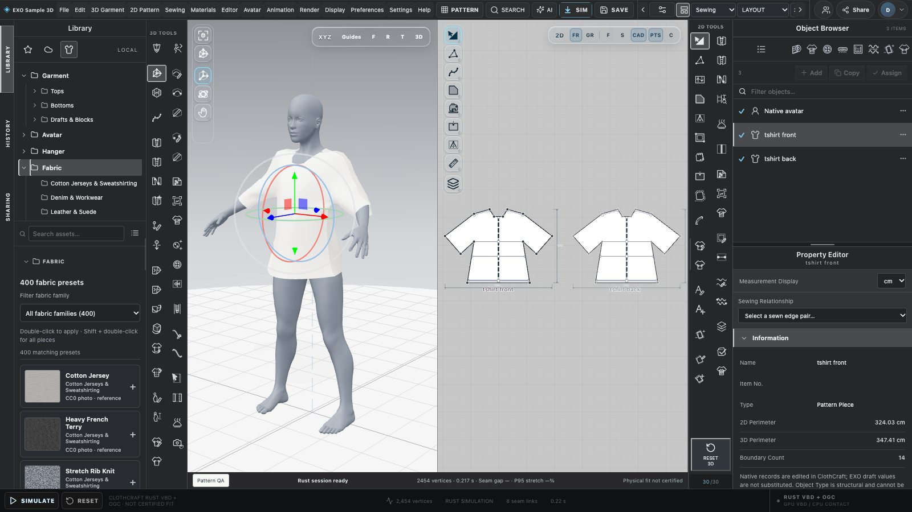](screenshots/clothcraft-v2-20261019-04-fabrics.jpg) | [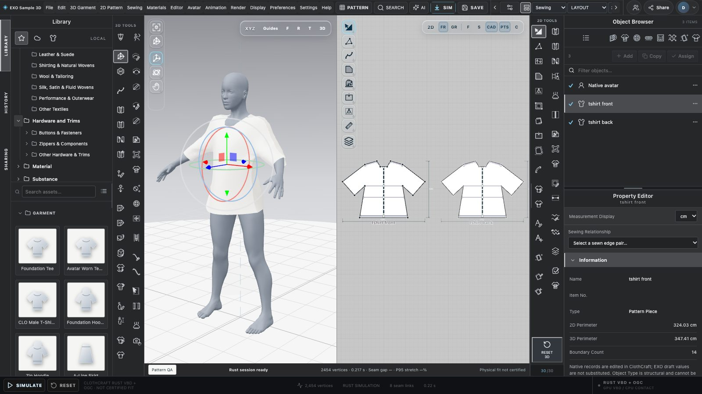](screenshots/clothcraft-v2-20261019-09-hardware.jpg) |

### 07 Technical packages and production engineering

The **Tech Pack workspace** is a major part of the product direction. There are working UI/editor paths for style specifications, POM and size tables, material/BOM information, construction details, review states and editable technical-package output. A newer development branch adds source-linked production review and guarded export behavior; factory sign-off and authenticated release are **not** yet achieved.

| Design and technical documentation | Complete technical-package page and specifications |
| :---: | :---: |
| [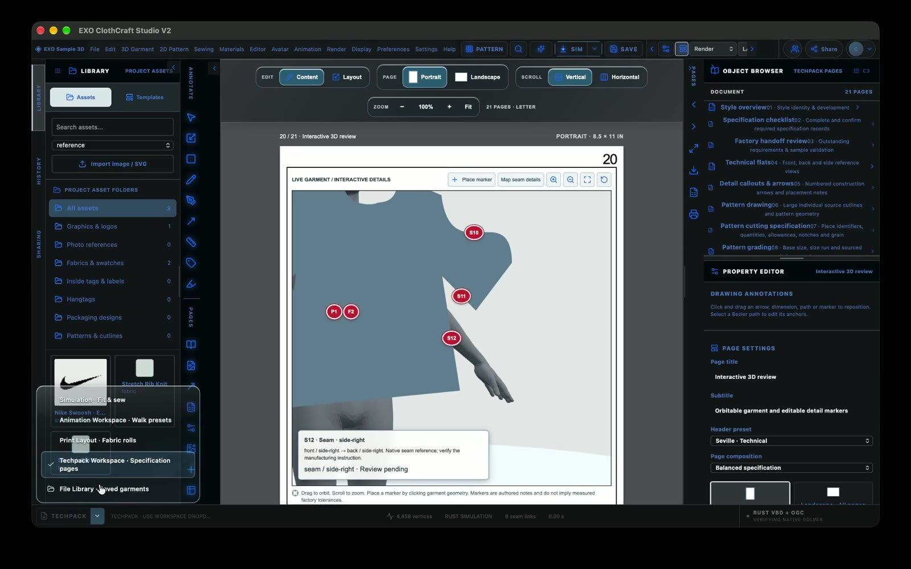](docs/gallery/2026-11/04-techpack-design.jpg) | [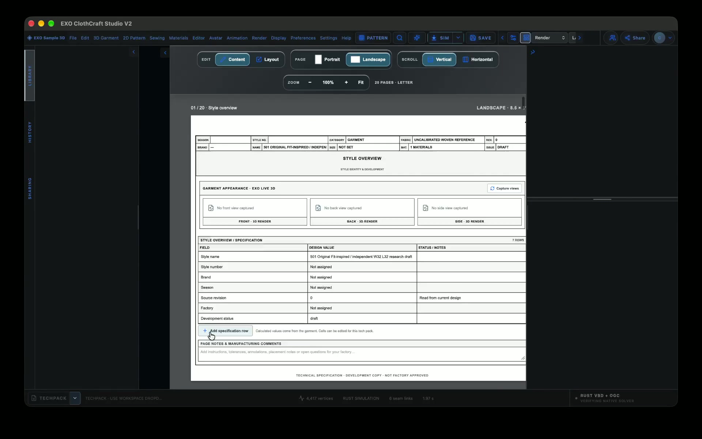](docs/gallery/2026-11/08-current-full-techpack-workspace.jpg) |

*Both images are from the October 29 real UI walkthrough. The right-hand image shows a complete technical specification page inside the Tech Pack workspace. These are editable development documents, not factory-approved specifications.*

### 08 Manufacturing exports and factory handoff

The codebase includes working or testable workflows for **DXF pattern export, grading data, marker/cutting layouts, BOM, POM, fabric use, costing, technical documents and factory export ZIPs**. These are development outputs: AAMA/ASTM receiving compatibility, full-scale calibration, real cutter acceptance and physical sample verification remain to be completed. Properly scaled industrial plotting and standard-printer tiling are important goals, not blanket guarantees for every pattern.

| Multi-piece pattern and size layout | Production/factory review interface |
| :---: | :---: |
| [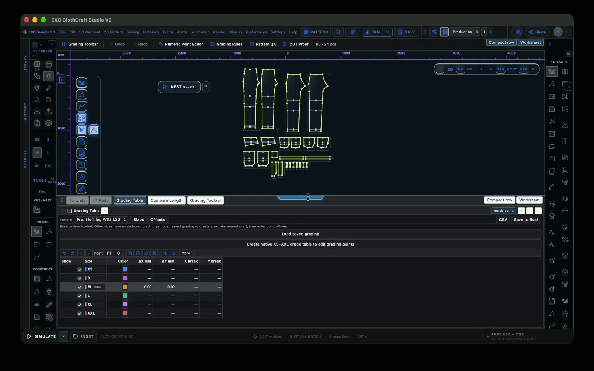](docs/gallery/2026-11/05-multipiece-patterns.jpg) | [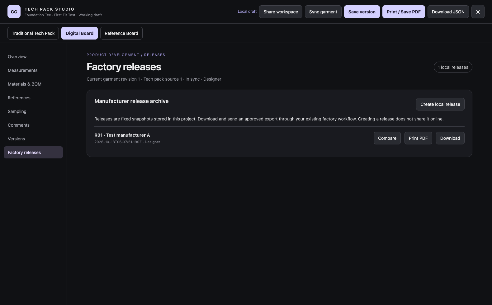](docs/gallery/2026-11/12-factory-review-workspace.png) |

For a deeper engineering description, see [the production pipeline](docs/EXO_PRODUCTION_PIPELINE.md), [technical-pack roadmap](docs/EXO_MASTER_ROADMAP.md) and [production status](docs/EXO_RELEASE_STATUS.md).

### 09 Render Studio and digital clothing

The Three.js environment supports interactive garment and avatar previews, materials, scene/lighting controls and image capture; OBJ/glTF/GLB-related interchange paths are under development. This also supports research toward clothing for **characters, animation and game assets**. It is a real-time visualization tool, not a proven path-traced or physically accepted cloth renderer.

| 3D clothing visualization | Customizable studio UI themes |
| :---: | :---: |
| [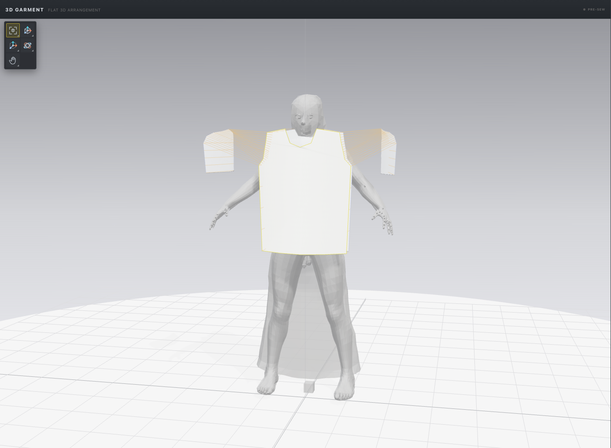](screenshots/exo-2026-3d-model-grid-detail.png) | [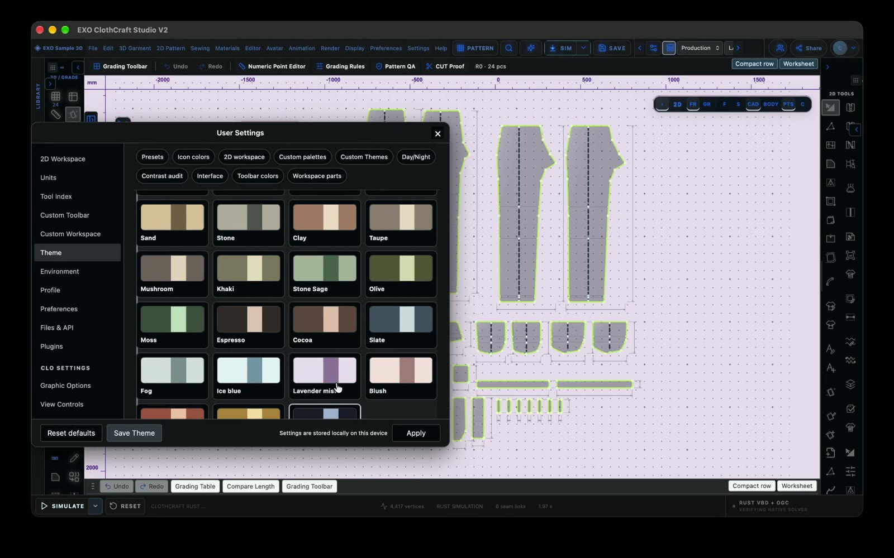](docs/gallery/2026-11/06-studio-themes.jpg) |

**More gallery context:** [UI capture provenance and limitations](docs/EXO_MEDIA_GALLERY.md) · [Full image timestamp/hash manifest](docs/gallery/2026-11/media-provenance.json) · [Detailed feature inventory](docs/EXO_FEATURE_ATLAS.md)

---

## What works and what's still in development

| System | Available now / current progress | Validation still required |
| --- | --- | --- |
| **2D pattern CAD** | Interactive editing, curves, dimensions, notches, allowance geometry, splitting/unfolding | Robust arbitrary commercial pattern round-trips and topology edge cases |
| **Size grading / POM** | Grading and measurements code, UI widgets, fixture-based tests | Industrial size-rule compatibility, independent measurement and size-set acceptance |
| **3D & sewing** | 2D/3D linkage, garment staging, sewn-edge authoring and preview | Collision-safe assembly, full multi-frame fabric/garment correctness |
| **Fabrics / rendering** | Material/preset libraries, PBR previews, viewport and image output | Measured textile behavior, cross-renderer and physical material calibration |
| **Tech packs** | Technical-pack editor, specs, BOM/POM and draft review/export paths | Factory-approved source traceability, validated prints and authenticated sign-off |
| **Manufacturing** | DXF, markers, BOM/POM, cost and factory package generation in selected paths | Importer/cutter review, plot scale, exact native/JS parity and physical sampling |
| **Automation** | Structured document and local experimental command/API tooling | Secure production workflow controls and integration reliability |

### How the design-to-production workflow is intended to fit together

**Draft the pattern → add sewing and construction → grade sizes and measure → stage/inspect in 3D → assign and visualize fabrics → verify the simulated behavior → produce tech packs and cut/marker files → review manufacturing preflight → independently sample and approve.** Each stage should reference the same versioned garment project rather than silently creating inconsistent files. Today, the individual modules exist at differing levels of maturity; this full flow is the product goal, **not an already-qualified manufacturing pipeline**.

### Two development efforts, one integration goal

The main **EXO / Cloth Craft Studio V2** application has the richer React/Three.js interface and pattern/manufacturing workflows, with optional C++ and early Rust modules. The separate [erythrofr/ClothCraft](https://github.com/erythrofr/ClothCraft) project is a Rust-native garment editor and simulation research system. The projects have separate maintainers and licenses. We are investigating a versioned interoperability bridge and selective Rust adoption so that the studio UI, pattern geometry, seams, materials and simulation can share consistent garment data—without claiming the two projects are already merged or that the upstream project is ours.

---

## Download the experimental macOS beta

**[Cloth Craft Studio V2 v0.3.0-beta.1 — Apple Silicon](https://github.com/mikristian/exo-sample-3d/releases/tag/v0.3.0-beta.1)** is an **unnotarized, experimental** application bundle for macOS 13+. It is a snapshot, not necessarily identical to the later local development screens shown above. Follow [the installation notes](docs/EXO_V2_UNNOTARIZED_BETA_INSTALL.md). Do not bypass system security globally; only approve the specific download after verifying that you trust it. Clean-Mac first-launch testing, complete native release review and factory-readiness verification remain outstanding.

---

## Quick start

### Requirements

- Node.js with npm (a current maintained LTS release recommended).
- Modern desktop browser with WebGL support; Google Chrome is used for many local UI regression captures.
- macOS or another OS capable of running the Vite development frontend.
- Extra native dependencies are optional; consult the backend documentation before enabling them.

### Run the browser workspace

~~~bash
git clone https://github.com/mikristian/exo-sample-3d.git
cd exo-sample-3d
npm ci
npm run dev
~~~

Open the local Vite address printed in your terminal (normally http://127.0.0.1:5173).

~~~bash
npm run build
npm run check:non-simulation
~~~

The browser CAD/editor is the lowest-friction starting point. **Do not assume that loading the editor means the Rust PPF or native XPBD service is installed.**

### Choose a simulation backend

**Browser preview** is available without a local native service. It is intended for iterative design feedback, not proof of cloth collision correctness.

**Rust PPF** is an optional separately installed research solver. Its external source and binary are not vendored in this GitHub repository.

~~~bash
npm run ppf:serve
npm run ppf:health
~~~

The PPF sidecar normally uses the loopback host on port 5192. Read [Rust backend setup](docs/RUST_BACKEND.md) and [simulation acceptance plan](docs/EXO_SIMULATION_RESEARCH.md) for prerequisites and limitations.

**Native XPBD / PositionBasedDynamics** is another optional path. macOS build tooling and a local upstream dependency clone may be required:

~~~bash
npm run dev:full
npm run check:native-service
~~~

The native sidecar uses the loopback host; actual port selection and build dependencies are documented in [developer guide](docs/EXO_DEVELOPER_GUIDE.md). It is an experimental backend, not a guaranteed replacement for the browser or Rust solver.

### Reproduce the archived October 19 UI gallery

For the archived October 19 ClothCraft Studio V2 gallery, start the first-party Vite UI (default for this capture: port 5386) and a **private** local Rust test server (default: port 5688). Load a non-personal Foundation Tee fixture in that private backend, then run:

~~~bash
node scripts/capture-clothcraft-v2-github-gallery.mjs
~~~

The script blocks production port 5385, routes all `/workspace` calls to the private backend, and records screenshot evidence in `screenshots/clothcraft-v2-20261019-capture-evidence.json`. It does not install dependencies or modify the real garment project.

To reproduce the earlier October 16 React/Three.js gallery:

~~~bash
npm run capture:gallery
~~~

Requires a local Google Chrome executable and the project dev server on port 5173. It captures a local **isolated testSession=tee** and does not read your regular saved garments. All gallery frames are real UI renders, not generated mock interfaces.

---

## Typical design-to-production workflow

1. **Create a garment** from a Foundation Tee, hoodie, pants or another supported starter and inspect its piece inventory.
2. **Draft the 2D pieces** using points, curves, measurement guides and internal construction lines. Preserve seam allowances and grain directions.
3. **Define sewing relationships** and verify boundary correspondence, sewing direction and staged placement in 3D.
4. **Choose an avatar** with suitable measurements. Use only assets with redistribution rights if sharing the project publicly.
5. **Assign materials** and inspect surface color, procedural weave, thickness, stretch, bending and material preview. Visual appearance and physical calibration are different tasks.
6. **Run an experimental preview**, checking against known failure modes: drift, body penetration, self-overlap, unstable seams, and inflated/stretched areas. Stop if the solver has not met acceptance criteria.
7. **Grade and measure** sizes only after checking POM conventions, layer overlap and construction constraints.
8. **Prepare manufacturing data** such as a BOM, graded DXF, markers and tech pack. Inspect each generated output against the original editable pattern and cutter requirements.
9. **Review production preflight blockers** and conduct a real sample validation. Generated files are not automatically approved factory instructions.
10. **Export and archive the project** using the canonical JSON model; keep design history, exact reference assets and test baselines traceable.

The [production guide](docs/EXO_PRODUCTION_PIPELINE.md) provides a more detailed process and file-level acceptance checklists.

---

## Project documentation

This repository includes **historic research logs** from October 2026 and a growing set of current, task-oriented manuals for contributors. Start with the [Documentation Index](docs/EXO_DOCUMENTATION_INDEX.md), which separates current guides from experimental notes.

| Deep-dive manual | What's inside |
| --- | --- |
| [Architecture](docs/EXO_ARCHITECTURE.md) | Module boundaries, UI/physics/production flow, interchange and service isolation |
| [Feature Atlas](docs/EXO_FEATURE_ATLAS.md) | Detailed capabilities and missing behavior for each editor and subsystem |
| [Canonical Data Model](docs/EXO_DATA_MODEL.md) | Project schema concepts, invariants, 2D/3D linkage and serialization |
| [Developer Guide](docs/EXO_DEVELOPER_GUIDE.md) | Local setup, command catalog, tests, APIs and debugging |
| [UI, Rendering and Avatars](docs/EXO_UI_RENDERING_AND_AVATARS.md) | Studio viewport, camera/grid, neutral 3D model, avatar formats and interface fidelity |
| [Fabric, Materials and Trims](docs/EXO_FABRIC_MATERIALS_AND_TRIMS.md) | PBR optics, physical textile parameters, colors and trim workflows |
| [Master Roadmap](docs/EXO_MASTER_ROADMAP.md) | Prioritized milestones, dependencies, implementation tasks and deliverables |
| [Simulation Research](docs/EXO_SIMULATION_RESEARCH.md) | Rust PPF/XPBD/JS comparison, stabilization, contact, physics and fit blockers |
| [Validation Test Plan](docs/EXO_VALIDATION_TEST_PLAN.md) | Benchmarks, fixtures, pass/fail criteria and repeatable verification |
| [Manufacturing Pipeline](docs/EXO_PRODUCTION_PIPELINE.md) | Grading, BOM/POM, DXF, marker, factory packaging and preflight |
| [Contributor Playbook](docs/EXO_CONTRIBUTION_GUIDE.md) | Review standards, subsystem ownership, good first issues and documentation hygiene |
| [Milestone Issue Board](docs/EXO_MILESTONE_ISSUE_BOARD.md) | 54 prioritized engineering tickets, dependencies and acceptance tests |
| [Project History](docs/EXO_PROJECT_HISTORY.md) | Dated architecture, feature development and experiment provenance |
| [Media Gallery](docs/EXO_MEDIA_GALLERY.md) | November 2026 visual tour and older real-UI capture evidence |
| [Release Readiness](docs/EXO_RELEASE_STATUS.md) | Public-source controls, current limitations and release checklist |

Additional system references: [Backend API](docs/BACKEND_API.md), [Existing architecture](docs/ARCHITECTURE.md), [Rust backend](docs/RUST_BACKEND.md), [Third-party licensing](docs/LICENSING.md), [Security](SECURITY.md), and the [legacy comprehensive parity plan](docs/GARMENT_STUDIO_COMPLETE_CLO3D_PARITY_MASTER_PLAN_2026-10-13.md).

---

## Roadmap at a glance

| Phase | Priority | Required result |
| --- | --- | --- |
| **01 — Baseline and reproducibility** | Immediate | Stable clean-checkout build, editor history, deterministic test garments, reliable CI |
| **02 — Geometry and sewing fidelity** | High | Consistent pattern edits, physical sewing constraints, measurable 2D/3D parity |
| **03 — Reliable fit on body** | Critical | Valid triangle contact, swept collision controls, robust seams and multi-frame convergence |
| **04 — Fabric realism and calibration** | High | Measured textile coefficients, consistent material mapping and controlled benchmark drape |
| **05 — Production handoff** | High | Exact graded geometry, vetted DXF, BOM/POM/markers, cutter-reviewed factory packages |
| **06 — Desktop / interoperability** | Planned | Native app parity where beneficial, resilient import/export and plugin architecture |
| **07 — Multi-user and automation** | Research | Versioned APIs, safe agent actions, provenance, releases and governance |

Progress is tracked through **measurable acceptance gates**, not a single headline completion percentage. In particular, mapping most exported functions into C++ does not imply a physically working, production-quality simulator.

Read the full [master roadmap](docs/EXO_MASTER_ROADMAP.md) for design constraints, ticket-level tasks, dependencies and test requirements.

---

## Repository map

| Path | Purpose |
| --- | --- |
| src/ | Main React app, UI components, garment-CAD domain logic, Three.js renderer |
| src/core/ | Geometry, drafting, sewing, simulation, materials, manufacturing and adapters |
| src/data/ | Sample templates and controlled test documents |
| scripts/ | Reproducibility, functional tests, visual QA and development tools |
| screenshots/ | Cloth Craft V2 interface screenshots and earlier research captures |
| docs/ | Master manuals, visual gallery, architectural notes, test reports and historic experiments |
| native_backend/ | Native XPBD/solver sidecar and interop experiments |
| ppf_backend/ | Integration server for external Rust PPF runtime |
| native_cpp/ | Optional C++ core, CLI and Qt desktop research path |
| blender_bridge/ | Blender import/scene/render interchange tools |
| .github/ | CI, issues, discussions and contribution templates |

Research clones, generated binaries, proprietary reference avatars, local user projects, credentials, SDKs and video render intermediates are intentionally excluded from Git. The full 7:24 UI walkthrough is hosted separately and linked from the README; only sourced still frames are committed here.

---

## Public-source safety and licensing

EXO Sample 3D original source is published under **GNU GPL-3.0-only** where rights are held; see [LICENSE](LICENSE). The project includes third-party components and CC0-origin MakeHuman reference assets that retain their own terms and notices. This repository does not provide the full upstream Rust solver, restricted CLO3D models, proprietary avatar files or other third-party datasets whose redistributable rights have not been established.

The project should be treated as **experimental engineering software**. No guarantee is made that a simulated garment will fit a human body, that cloth penetration is resolved, or that any automated manufacturing files are approved for industrial use.

For vulnerability reporting and responsible release handling see [SECURITY.md](SECURITY.md). For detailed third-party rights review see [docs/LICENSING.md](docs/LICENSING.md). Contributors must not add copyrighted garments/avatars, private API keys, licensed commercial software resources or confidential factory data without permission.

---

## Contributing

Constructive contributions are welcome in pattern CAD, physically credible cloth simulation, mesh topology, avatar/collision systems, material calibration, performance, visual tooling, export fidelity and test infrastructure.

1. Read [CONTRIBUTING.md](CONTRIBUTING.md), the [developer guide](docs/EXO_DEVELOPER_GUIDE.md) and [contributor playbook](docs/EXO_CONTRIBUTION_GUIDE.md).
2. Choose a reproducible issue with a clear fixture and expected behavior.
3. Supply the smallest change possible, plus focused tests and parity diagnostics.
4. Keep provenance and third-party license notices in your PR.
5. Do not report passing CTest alone as complete physical-fit certification.
6. Discuss changes to the canonical garment document format or solver-backend contract before merging.

**Cloth Craft Studio V2 is work in progress toward a professional bridge between fashion design, pattern engineering, 3D clothing and real-world manufacturing.**
