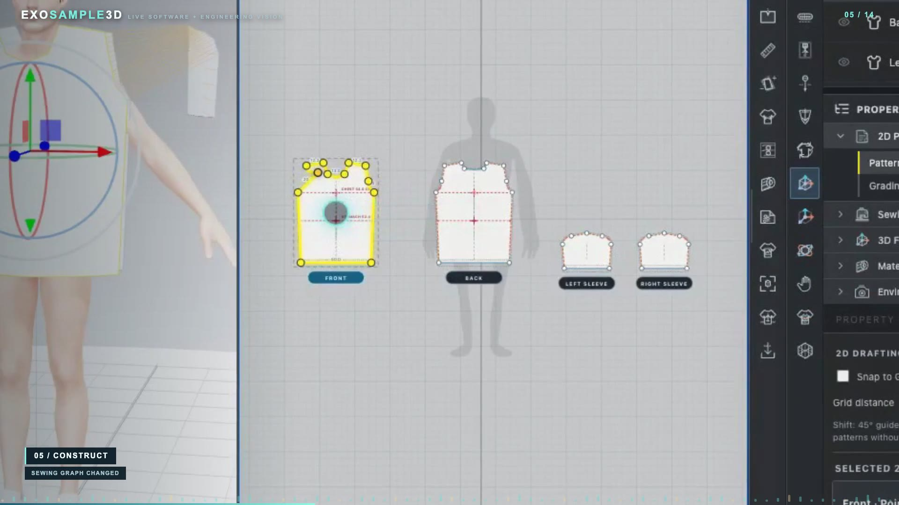
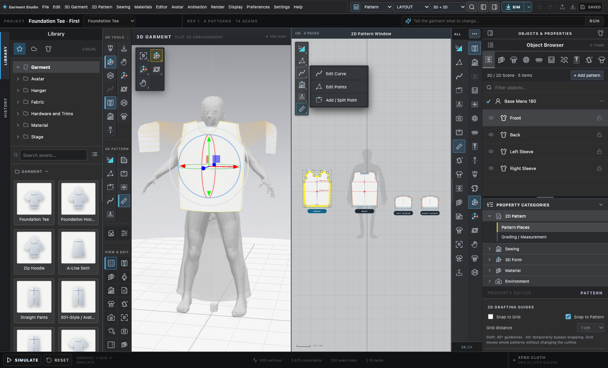
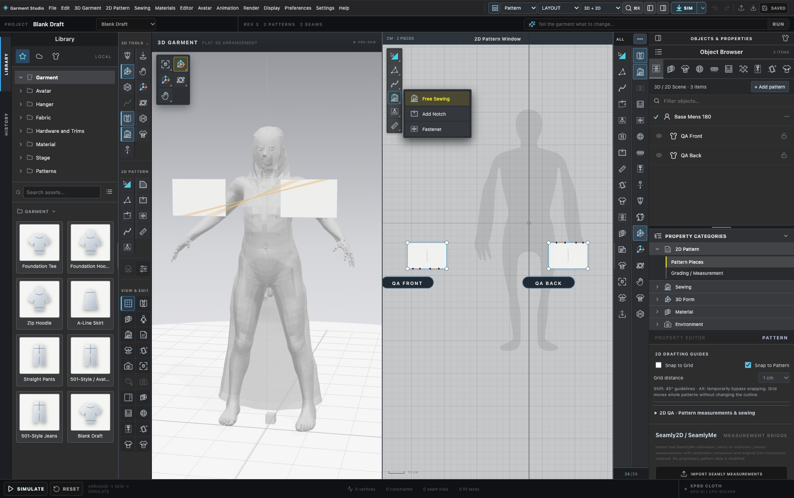
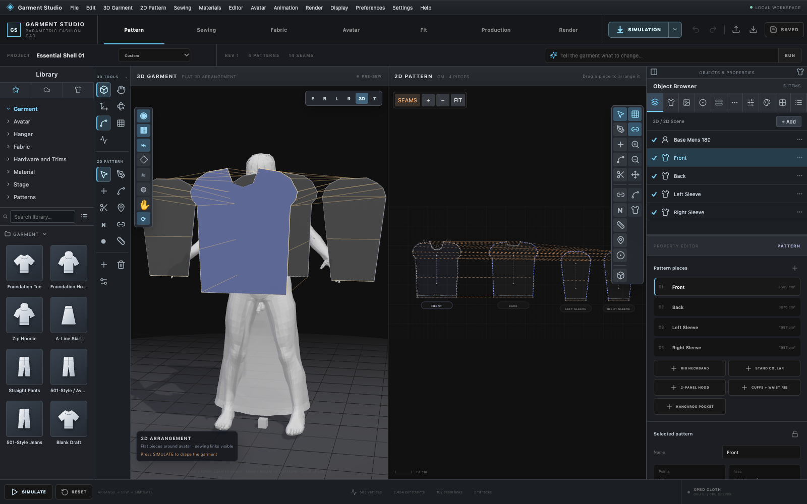
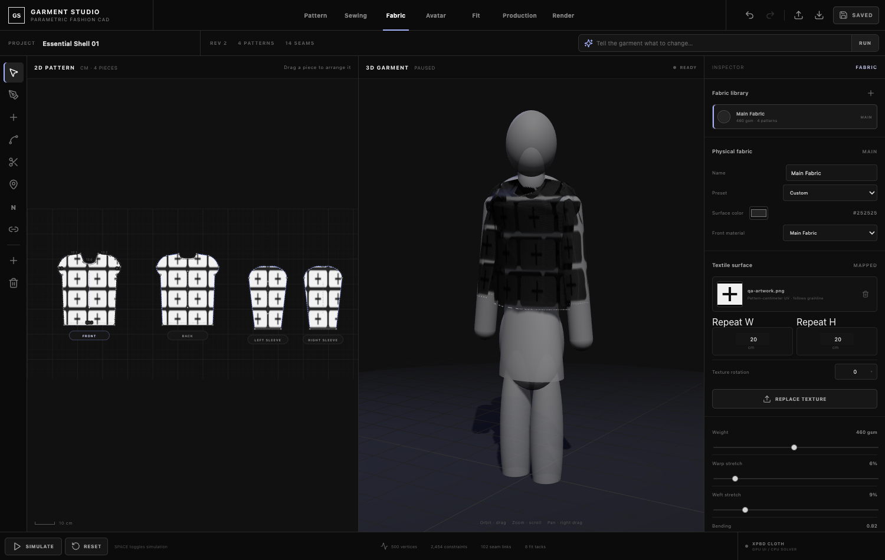
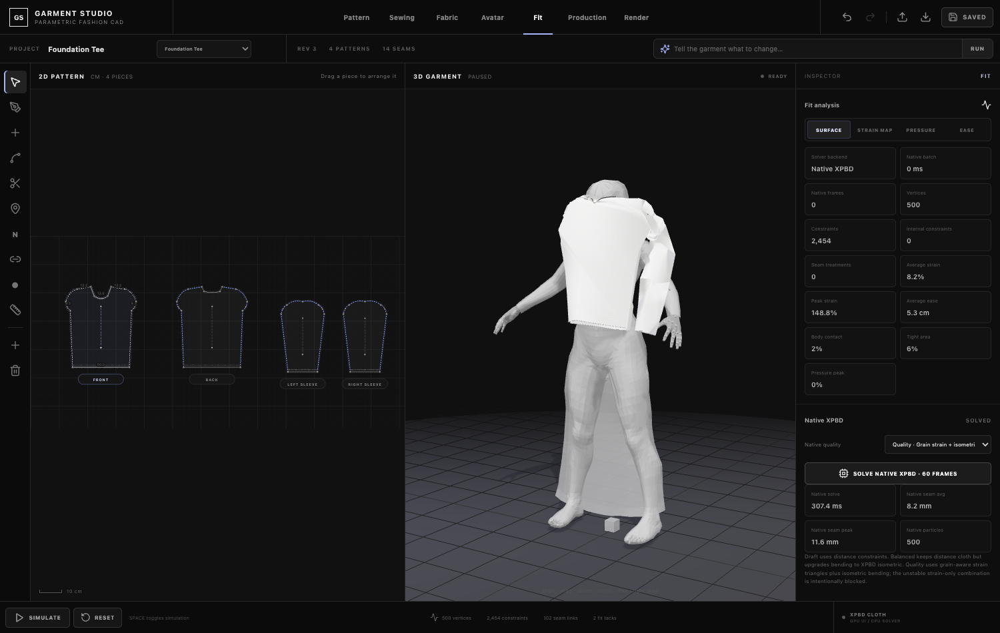
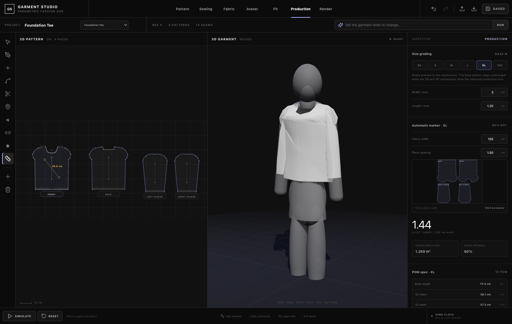
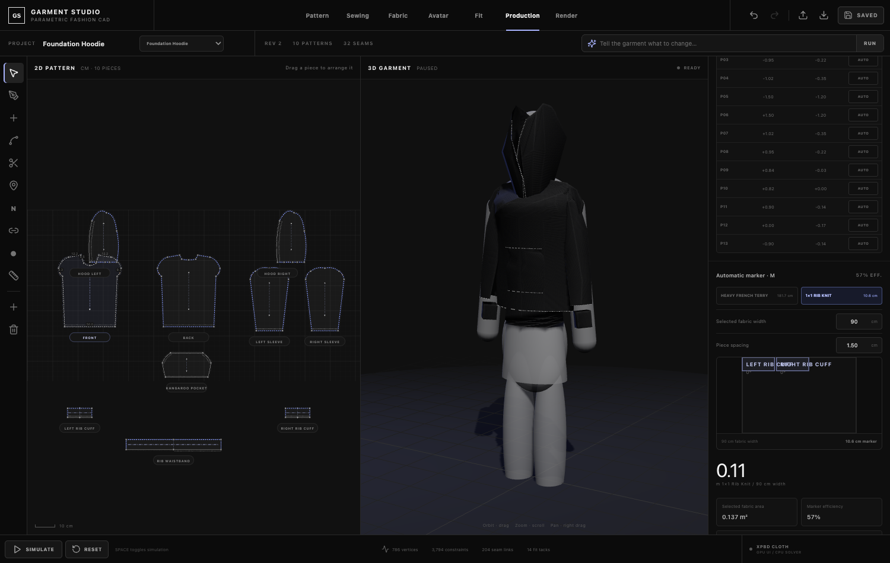

# Garment Studio

Garment Studio is an open garment-CAD, cloth-simulation and apparel-production platform in active development. The project is building a workflow for 2D sewing patterns, 3D fitting, fabric simulation, avatars, grading, markers, DXF, tech packs, rendering and programmable/AI garment operations.

The goal is not to copy proprietary software or assets. The goal is an interoperable, extensible open platform for computational fashion.

## V16 showcase film

[](media/garment-studio-v16-promo.mp4)

**[Watch / download the complete V16 promotional film (MP4)](media/garment-studio-v16-promo.mp4)** — 2 minutes 57 seconds, 1080p, mastered stereo audio. The original high-bitrate master is retained locally; the repository contains a GitHub-friendly H.264 encode with the same full sequence and soundtrack.

The film shows the application's evolving UI and experimental simulation functionality. It is a development showcase, not a certification of physical fit, collision-free drape, manufacturing readiness, or equivalence to commercial software.

## Garment Studio interface

Actual application screenshots from the development workspace:

| 2D + 3D pattern workspace | Free sewing and seam tools |
| --- | --- |
|  |  |

| Construction and seam layout | Fabric appearance and UV textures |
| --- | --- |
|  |  |

| Experimental native fit analysis | Multi-size production and marker layout |
| --- | --- |
|  |  |



These are progress snapshots of actual UI states. Some 3D previews show unresolved cloth or fit artifacts; production validation remains in progress.

## Current capabilities

- editable 2D pattern pieces with quadratic curves, internal lines and seam allowances
- sewing graph with partial seams, reverse direction, ease/gather/elastic treatments
- real-time browser cloth preview with self/body collision and fit analysis
- multiple garment foundations including tee, hoodie, zip hoodie and pants
- fabrics with directional stretch/shrink, bend, thickness, damping and friction
- avatars with measurement-driven body dimensions and arm pose
- trims including zippers, buttons, buttonholes, bindings, topstitching and fasteners
- lining and fused interfacing layers
- per-point grading, grade nests and multi-size production runs
- polygon marker placement and multi-fabric markers
- DXF import/export, OBJ/GLB export, POM CSV, tech-pack and factory-package export
- GarmentCode/PyGarment JSON bridge
- swappable simulation-backend protocol
- live native PositionBasedDynamics XPBD backend on Apple Silicon with resumable stepping, self/body collision and fit/pressure analysis

## Architecture direction

Garment Studio keeps one canonical garment document and treats major engines as replaceable backends:

- **Pattern CAD:** Garment Studio + GarmentCode/PyGarment adapters
- **Simulation:** browser preview, native XPBD/PBD, optional CUDA/neural backends
- **3D platform:** Blender integration for scene, mesh, avatar, rendering and animation
- **Production:** Garment Studio grading, marker, DXF, BOM, POM and factory handoff
- **Automation:** stable document/backend APIs for agents and external tools

See `docs/ARCHITECTURE.md` and `research/OPEN_SOURCE_ACCELERATION.md`.

## Quick start

```bash
npm install
npm run dev
```

For the full local stack with the compiled native XPBD solver available in the Fit backend selector:

```bash
npm run dev:full
```

This starts the Vite UI and the local native solver sidecar on `127.0.0.1:5194`. The browser-only solver remains available when the sidecar is not running.

Production build:

```bash
npm run build
```

Core regression suite:

```bash
npm run check
```

Focused integration checks:

```bash
npm run check:garmentcode
npm run check:backend
npm run check:native-xpbd
npm run check:native-garment
npm run check:native-service
npm run check:blender
```

The native XPBD check builds the upstream MIT PositionBasedDynamics core from a local research clone under `research/oss/PositionBasedDynamics`. Research clones are deliberately ignored by Git.

## Rust PPF solver option

The project retains its existing Rust-based PPF Contact Solver integration.
The runtime is an optional external dependency, not a prerequisite to
completing a C++ conversion. You can run the browser application without
the local Rust service; if you have installed and configured the PPF solver,
run `npm run ppf:serve` and verify with `npm run ppf:health`.

See [Rust backend setup and licensing](docs/RUST_BACKEND.md). The C++/Qt
research and native XPBD sources remain in the repository but are optional.

## GitHub source repository

The source tree includes frontend code, CAD tooling, solver bridges, tests,
optional native desktop source and GitHub Actions workflows. Large SDKs,
local builds, recordings, user avatars and upstream third-party source
checkouts are deliberately excluded from Git. See
[GitHub publishing and setup](docs/GITHUB_SETUP.md).

## Contributing

Start with `CONTRIBUTING.md`. Major solver or document-format changes require an RFC/architecture discussion because the project is designed for multiple independent backends.

High-value contribution areas include cloth physics, collision, pattern CAD, Blender integration, avatars, rendering, industrial DXF, marker optimization, fabric calibration and benchmark garments.

## License and release status

Garment Studio original source is intended to be distributed under **GNU GPL-3.0-only**; see [`LICENSE`](LICENSE). Third-party components and assets retain their own licenses. The current local working tree is **not yet a cleared public distribution**: proprietary avatars, third-party dependency notices, contributor rights and Git history must be audited before publishing.
