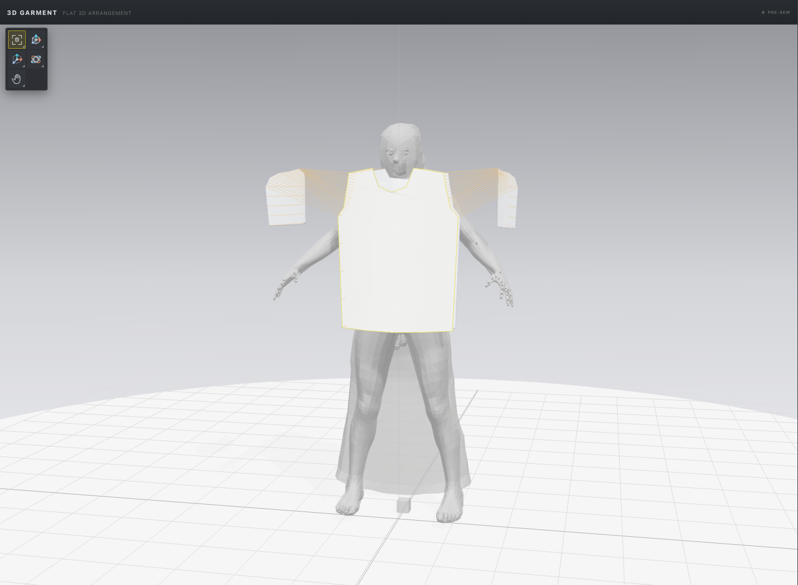
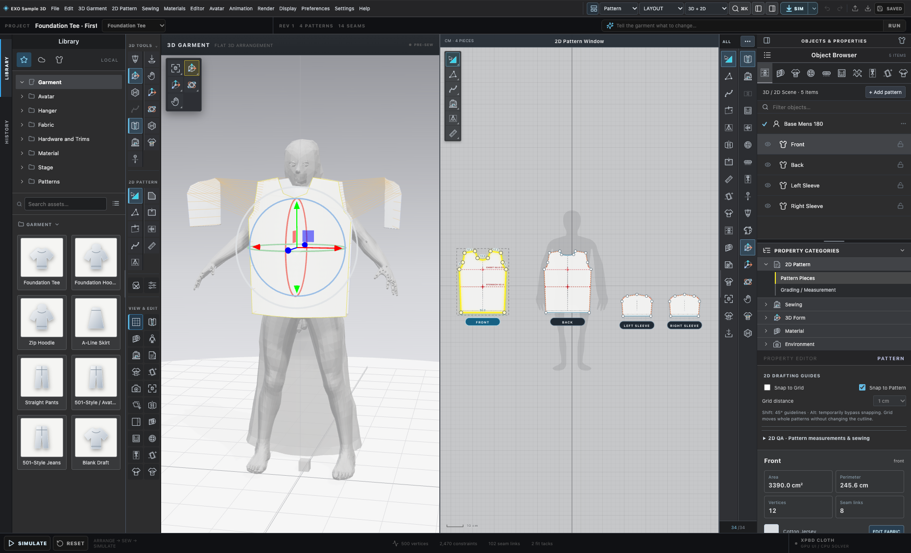

# Cloth Craft Studio V2 — UI gallery provenance and evidence

## Expanded November 6, 2026 GitHub presentation

The [front-page gallery](../README.md#explore-the-application) now includes selected real interface scenes from the **October 29, 2026 7-minute 24-second Cloth Craft Studio V2 UI tour**, a **second full-page Tech Pack view** from that same recording, and additional genuine drafting/grading/arrangement QA images. The video is independently reachable at [the dedicated playback page](https://exo-clothcraft-video.vercel.app/) and [direct MP4](https://exo-clothcraft-video.vercel.app/exo-studio-tour.mp4). Video-derived stills live under [`docs/gallery/2026-11/`](gallery/2026-11/) and carry source timecodes and SHA-256 checksums in [`media-provenance.json`](gallery/2026-11/media-provenance.json).

| Gallery section | Evidence | Interpretation |
| --- | --- | --- |
| [Connected Studio](gallery/2026-11/07-studio-overview.jpg) | Video frame at 07:06 | Actual split 2D/3D editor, not a finished cloth-fit result |
| [2D Drafting](gallery/2026-11/02-pattern-drafting.jpg) | Video frame at 02:28 | Onscreen real pattern editing |
| [Grading](gallery/2026-11/01-size-grading.jpg) | Video frame at 00:35 | Grading comparison board and tools, not graded factory certification |
| [3D garment](gallery/2026-11/03-linked-2d-3d.jpg) | Video frame at 03:39 | Real avatar and garment display, not validated moving-cloth contact |
| [Technical pack](gallery/2026-11/04-techpack-design.jpg) | Video frame at 04:40 | Technical documentation UI |
| [Full Tech Pack document view](gallery/2026-11/08-current-full-techpack-workspace.jpg) | Oct 29 tour frame at 04:56 | A full technical specification page within the actual Tech Pack editor; not a factory-approved production release |
| [Multi-piece pattern layout](gallery/2026-11/05-multipiece-patterns.jpg) | Video frame at 05:17 | Editable pattern assembly and sizing context |
| [Studio themes](gallery/2026-11/06-studio-themes.jpg) | Video frame at 06:15 | UI customization settings |
| [Hoodie arrangement](gallery/2026-11/11-hoodie-panel-arrangement.png) | First-party QA screenshot, October 18 | Experimental staging, not production-ready draping |
| [Factory review](gallery/2026-11/12-factory-review-workspace.png) | First-party QA screenshot, October 18 | Experimental release/review UI, not signed-off manufacturing |

**What was not added:** proprietary CLO3D UI or restricted avatar assets, third-party commercial garment imagery, private user's garments, artificial composite “success” screenshots, unreviewed audio/movie intermediates, or the older V16 film. The full 7:24 movie is linked from the existing video host rather than duplicated as a large Git blob.

**Build vs. release caveat:** The Oct 29 frames come from an active development build, while the public beta installer is `v0.3.0-beta.1`. A feature pictured in the later recording should not be interpreted as guaranteed to ship in that earlier beta. Every gallery frame is observational UI evidence—not acceptance of cloth physics, cut-piece geometry, advanced grading, or authenticated factory release.

## Archived October 19, 2026 base gallery

This document explains what the real UI screenshots in the public repository show, how they were captured, and the limits of their evidence.

### October 19 base capture (archived)

Captured directly from the currently running EXO ClothCraft V2 React/Three.js application in a fresh **1600 × 900** Chrome browser context. All `/workspace` calls were routed to an isolated local Rust backend; any request to production port 5385 was blocked. The visible neutral fitting avatar and T-shirt belong to the first-party test scene. Screenshots show the actual UI, not a finished physics fit, commercial CLO3D interface, AI-generated mockup or claimed manufacturing result.

| Screenshot | What it really shows |
| --- | --- |
| [Studio overview](../screenshots/clothcraft-v2-20261019-01-overview.jpg) | Garment library, neutral avatar, live 3D canvas, actual 2D cutlines and property editor |
| [2D detail](../screenshots/clothcraft-v2-20261019-02-pattern-drafting.jpg) | Actual visible editable pattern surface cropped from the 2D board |
| [Sewing UI](../screenshots/clothcraft-v2-20261019-03-sewing.jpg) | Sewing workspace selected, with sewn-edge selector and interface controls |
| [Fabric library](../screenshots/clothcraft-v2-20261019-04-fabrics.jpg) | Actual fabric browser and material swatches; no unverified material application claim |
| [Garment library](../screenshots/clothcraft-v2-20261019-06-garments.jpg) | Starter garment tiles and folder tree |
| [3D detail](../screenshots/clothcraft-v2-20261019-07-3d-viewport.jpg) | Live neutral 3D fitting avatar and garment, cropped from canvas |
| [Theme settings](../screenshots/clothcraft-v2-20261019-08-theme-settings.jpg) | Available preset palette choices in the actual settings dialog |
| [Hardware tree](../screenshots/clothcraft-v2-20261019-09-hardware.jpg) | Expanded hardware/trim library folders |

Repeat the capture when the real interface changes:

~~~bash
node scripts/capture-clothcraft-v2-github-gallery.mjs
~~~

The script expects the first-party UI at `127.0.0.1:5386` and private backend at `127.0.0.1:5688`. It writes JPEGs and a JSON capture evidence manifest in `screenshots/`. It neither edits native project data nor connects to production data.

## Earlier gallery (October 16, 2026)

The eight earlier gallery screenshots were captured with the React/Three.js application using an isolated **Foundation Tee** fixture, the first-party workspace UI, a neutral **MakeHuman-derived fitting avatar**, and its real 3D floor grid. These images are retained as historical comparisons. Screen sizes are approximately 1860×1130 for full UI images. They are neither outputs from CLO3D nor AI-generated replicas.

| Asset | Scene shown | Important limitation |
| --- | --- | --- |
| [Current linked pattern and 3D](../screenshots/exo-2026-current-pattern-and-3d-grid.png) | Editable 2D tee pieces and staged 3D geometry simultaneously | Panels are staged, not a stable sewn final garment |
| [Full 3D fitting avatar and floor grid](../screenshots/exo-2026-current-3d-garment-grid.png) | Neutral mannequin, viewport, grid, garment panels | Neutral base mesh does not prove calibrated anthropometric fit |
| [2D pattern grid](../screenshots/exo-2026-current-2d-pattern-grid.png) | Pattern point and curve guides, construction layout | Sample template only |
| [Fabric editor and garment](../screenshots/exo-2026-fabric-and-3d-grid.png) | Materials workspace beside 3D/2D | Optical controls are not physical-fabric measurement results |
| [Cropped fabric 3D](../screenshots/exo-2026-fabric-viewport.png) | 3D fabric and avatar preview | Surface shading/texture mapping remains under verification |
| [Render Studio](../screenshots/exo-2026-3d-render-studio.png) | 3D-only layout, floor grid and render inspector | Live WebGL stage, not path tracing or final product photography |
| [Neutral mannequin close view](../screenshots/exo-2026-3d-model-grid-detail.png) | Clearer neutral fitting figure on ground grid | Real staged garment, no certified simulated final shape |
| [Sewing workspace](../screenshots/exo-2026-sewing-workspace.png) | Sewing mode, panels, garment workspaces | Full complex seam/contact behavior under development |

### Natural 3D ground grid

The grid is generated by Three.js as a floor/axis reference. It is not an AI-generated floor background, and the garment model is derived from the local first-party Foundation Tee test garment. Real mannequin geometry may show a low-poly or unfinished appearance, which is more truthful than a generic fashion-model illustration.

### 2D↔3D editing

The dual workspaces are intended to support pattern drafting and immediate 3D spatial feedback. They do not themselves establish sewn fabric correctness. For real garment realism work, contributors should compare the same documented pattern under staging and time-integrated simulation and record penetration/stretch errors.

## Earlier gallery capture method

The repeatable gallery capture script is [scripts/capture-exo-public-gallery.mjs](../scripts/capture-exo-public-gallery.mjs). It uses Playwright Core with a locally installed Google Chrome browser and an isolated in-browser test session to avoid modifying normal saved user garments.

Start Vite in one terminal:

~~~bash
npm ci
npm run dev
~~~

From another terminal:

~~~bash
npm run capture:gallery
~~~

The browser session points to http://127.0.0.1:5173/?desktop=1&testSession=tee by default, opens a fresh isolated browser context, and visits the drafting, materials, render and sewing workspaces. Override the local origin using EXO_SCREENSHOT_ORIGIN; override Chrome executable using EXO_CHROME_PATH if needed. If the fixture is missing or WebGL can't render, the command should fail rather than output fabricated or empty “proof.”

**Rights and privacy checks before merging photos:**

- Do not capture signed-in dashboards, people, commercial third-party app UI, or private saved garments.
- Do not put the local restricted CLO/Thomas avatar or its screenshots in the public repository.
- Use project-owned graphics and demonstrably permissive/CC0 avatar imagery with appropriate license records.
- Preserve raw genuine interface evidence, including visible limitations. Only crop/resize for layout; no deceptive compositing.
- Keep screenshots to useful representative scenes. Update after meaningful UI changes instead of filling the README with old duplicates.
- A photo of a real sewn garment would require provenance, permissions and sample-fit annotations, and is **not equivalent** to a simulation screenshot.

## Video and media publication

The outdated V16 promotional MP4 and its poster were removed from the current GitHub repository tree. The newer October 29 7:24 video is hosted externally and linked for viewers alongside real screenshots. Historic Git commits may still reference those files; this update does not rewrite repository history. Local film masters stay in the existing ignored working folders.

## Media acceptance checklist

- [x] New October 29 tour stills and October 25 tech pack integrated into README.
- [x] Eight October 19 baseline Cloth Craft Studio V2 screenshots retained and linked.
- [x] Earlier first-party screenshots documented separately.
- [x] Neutral avatar and natural 3D ground grid visible.
- [x] Outdated showcase video removed from the current repository tree and README.
- [x] No restricted proprietary CLO avatar copied into the public gallery.
- [x] Simulated/factory functionality caveats in user-facing copy.
- [ ] Confirm a future professionally draped, collision-correct garment from benchmarks.
- [ ] Add measured fabric optical/physical comparisons with controlled lighting.
- [ ] Record publication permissions/provenance for future outside contributors' media.

---

Return to the [README](../README.md), the [documentation index](EXO_DOCUMENTATION_INDEX.md), or the [master roadmap](EXO_MASTER_ROADMAP.md).
