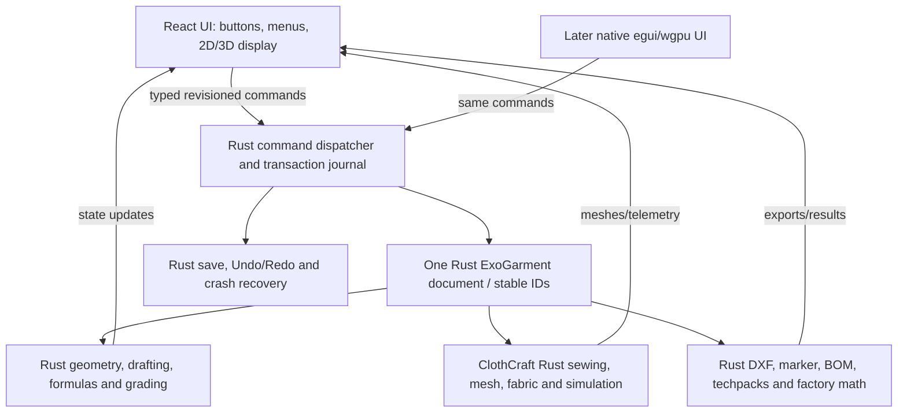

# EXO two-stage migration: React UI → Rust + ClothCraft → Rust-native UI

**Proposed plan, not completed code migration.** Prepared 2026-11-15 against public GitHub EXO commit `f7d007d2cbddad179f4272437af7e29189e15ee9`. Scope: **existing reachable EXO functionality**, preserving current limitations and *not* adding CLO3D/Optitex features. The current application and installed personal app are unchanged by these documents.

## Summary decision

**Stage A (first): Retain EXO's React/CSS 2D/3D editor, menus, buttons, panels and macOS WebKit presentation. Move all actual state-changing and numerical operations underneath those controls into Rust and connect to pinned ClothCraft.** React stays responsible for layout, click handling, drawing frames and showing results, never as authoritative owner of geometry, sewing, grading, physics, manufacturing records or Undo/Redo.

**Stage B (second): Replace React interface sections one at a time with native Rust egui/wgpu, using the *same Rust garment document and command API*.** Begin with low-risk views and keep React usable until native replacements pass parity tests. Do not rewrite the backend for Stage B.

### Target architecture

**Key invariant:** one *authoritative* Rust revision of every garment document, piece/edge/seam/notch/size/fabric and export. React and ClothCraft may cache render state but may not mutate a second canonical garment. Use versioned commands `{schemaVersion, projectId, revision, commandId, actorScope, payload}`, explicit SI↔millimetre conversion, typed errors, stale revision rejection, and authenticated source-pinned native/WASM boundaries. Preserve separately maintained ClothCraft licenses and isolate EXO-specific adapters. Node and Swift may remain thin UI/OS bridges, but not authoritative engineering decision-makers.

## Stage A — keep React, convert the existing application logic

| Workstream | Functions to convert | Acceptance test |
|---|---|---|
| 0. Reachable action inventory | Trace every active button/menu/shortcut to JS, C++ and Rust handlers; classify duplicates, UI-only actions and dormant experiments | Full maintained per-button ledger; mandatory scope has an identified owner |
| 1. Canonical Rust garment | Project data, pieces, edge IDs, seam/notch/size identities, fabric/material metadata | V2→Rust round-trip, explicit unit conversion, no lost fields, malformed schema rejected |
| 2. Rust commands and history | Typed edits, authentication, transactions, Undo/Redo and atomic save | UI edit → save → process exit → cold reopen → Undo/Redo → equivalent output; stale commands rejected |
| 3. CAD and grading | Curves, snapping, topology, formulas, measurements, POM and graded sizes | Four-piece tee, six distinct XS–XXL sizes, same measurements and stable IDs |
| 4. Sewing and meshing | Sew/unsow, reversals, notches, allowances, tessellation and edge mappings | Real React edit changes same Rust mesh and can be undone without ID corruption |
| 5. ClothCraft integration | Source-pinned ClothCraft simulator, avatars, collisions, fabric settings, 3D mesh updates and telemetry | Existing simulate button invokes real Rust; physical failures are reported, not mislabeled success |
| 6. Manufacturing | DXF, marker, physical plot, BOM/POM, techpacks, packages and costing | Reference outputs reproduce existing behavior; factory accuracy approval stays separate |
| 7. Remaining active actions | Asset tools, libraries, settings, AI command orchestration, imports and source business logic | Every reachable action Rust verified, UI-only or clearly blocked; no silent fallback |
| 8. Source-built release | Original React/CSS interface and existing app shell | Independent macOS candidate, security tests, per-button ledger, source manifest, rollback; installed personal app untouched |

**Stage A planning:** **12–20 human developers and 40–80 scoped AI agent assignments, approximately 3–6 months** for broad existing active-feature parity. Agent counts refer to *jobs*, not simultaneous sessions or human FTE. A **30-day first-pass attempt** could use **15–25 humans and 40–90 AI assignments**, but cannot guarantee every current button passes integration tests. A smaller **8–12 human/20–40 AI assignment** first-month team could instead complete a coherent T-shirt vertical slice.

### Days 1–30 sprint gates

| Dates | Work | Measurable gate |
|---|---|---|
| Days 1–7 | Pin EXO/ClothCraft source, inventory reachable buttons, freeze schema/unit/command contract | Rust garment round-trips real tee without metadata loss; owners recorded |
| Days 8–14 | Rust pattern-edit commands, six-size grading and history integrated with *real React controls* | Edit → grade → save/reopen → Undo/Redo survives separate Rust process |
| Days 15–21 | Rust sewing/mesh, actual ClothCraft invocation, materials and exports; parallel independent tools | UI displays real Rust mesh and solver failures; output identities/units preserved |
| Days 22–30 | Browser + Mac app end-to-end QA, regressions, error recovery, isolated preview release | Tested buttons enumerated, others visibly blocked; no unverified parity claim |

Thirty days is a sprint, **not a guaranteed total conversion deadline**. Translating a handler does not prove it is wired into the running app. Physics accuracy is separate: the real six-size tee still fails physical seam closure/strain even though Rust CPU simulations execute.

## Stage B — progressively convert React interface to Rust

| Order | Native Rust UI part | Migration and acceptance |
|---:|---|---|
| 1 | Settings, preferences, dialogs | Isolated Rust-native window; keyboard, focus, input and persistence parity |
| 2 | Project browser and library | Rust file picker, project select/import/export, cancel/permission handling |
| 3 | Fabric, materials and property inspectors | Native tables/sliders calling identical Rust command; no unintended solver reset |
| 4 | Grading/POM size tables | Same Rust six-size grade catalog, reversible edits and exact readback |
| 5 | 2D editor and drawing tools | egui/wgpu canvas, zoom, snapping, selection, curve edits; numeric precision and screenshot tests |
| 6 | 3D preview/avatars | wgpu view on *same garment mesh* and selection IDs, camera controls and GPU recovery |
| 7 | Sewing and simulation workspace | Native controls invoke ClothCraft, show real metrics/errors, preserve interactions |
| 8 | Shell, accessibility and packaging | Replace WebView only after all paths pass; native menus, clean macOS install, signing/notarization, rollback |

**Stage B planning:** **8–12 human native Rust UI/graphics/platform engineers with 20–40 AI-agent assignments, 6–12+ months total** once Stage A command model is stable. Individual low-risk windows may be 1–2-month efforts; phases may overlap late. A React component cannot simply be inserted as an egui widget into the same DOM: a hybrid needs separate native panels/windows or carefully scoped workspace replacement. The backend remains the same.

## Strict definition of done

1. The real app button calls the source-pinned Rust implementation, not a JS/C++ computational fallback. Rust source files and green compilation are insufficient.
2. Positive and negative tests on reference projects, same geometry, units, IDs and saved exports; stale revisions and bad inputs leave projects unchanged.
3. Native Undo/Redo, crash-safe cold reopen, old project migration and preserved piece/edge/seam/notch identities.
4. ClothCraft simulation must report actual metrics and preserved existing limitations; visual drape is not calibrated physical fit.
5. Factory exports require an independent industrial CAD receiver and physical cut/sample validation for *approval*; migration parity alone is not factory certification.
6. Stage B UI tools require real keyboard/pointer testing, screenshots, accessibility, Mac app lifecycle and safe rollback.

## Tracking and AI-agent process

Use `EXO_REACT_RUST_CLOTHCRAFT_PHASE_MATRIX_20261115.csv` for all **41 existing system IDs** and `BUTTON_PARITY_LEDGER_TEMPLATE.csv` for actual reachable UI actions. System plan statuses start `NOT_AUDITED` until runtime evidence exists; this is *not* a claim the associated code is absent. Supported button statuses: `NOT_AUDITED`, `IMPLEMENTED_NOT_TESTED`, `RUST_VERIFIED`, `UI_ONLY`, `BLOCKED`.

Each AI agent gets a narrow independent Rust conversion, test, command mapping or audit job pinned to source revision, with its own code review and CI run. Agent count represents assignments, not concurrent sessions. First settle schema/command conventions; 100 agents editing the same project/bridge increases conflicts rather than speed.

## Actual current checkpoint and dependencies

The older source audit reported **24,046 Rust / 258,496 first-party source lines (9.30%)** and **7,128 / 138,170 mapped backend source lines (5.16%)**. Neither measures complete functionality, and both snapshots predate newer work. The V2 React UI still calls JavaScript CAD functions directly and a hybrid mode can retain separate EXO draft state. The [2026-11-15 six-size four-panel tee integration](../reports/EXO_FOUNDATION_TEE_SIX_SIZE_E2E_QA_20261115.md) proved six native grades/meshes, sewing connections, three Rust CPU steps per size and cold-restart native history, **but physical seams remain roughly 1.08–1.13 metres apart and strain is excessive; fit gate fails**. Do not quietly convert those failures to successes.

**First implementation checkpoint:** a *real React control* modifies the same four-piece six-size tee in Rust, ClothCraft uses that exact document to compile its mesh, and the changes survive Rust Undo/Redo, cold restart and DXF without ID or factory metadata loss. This is an implementation acceptance target, not a current completed claim.

## Source references

- [All 41 system build plans](SYSTEM_PLANS.md)
- [Dependency-ordered Rust task board](TASK_BOARD.md)
- [AI-inclusive staffing analysis and alternative 30-day scenarios](EXO_FULL_RUST_41_SYSTEM_STAFFING_20261115.md)
- [Phase ownership CSV](EXO_REACT_RUST_CLOTHCRAFT_PHASE_MATRIX_20261115.csv)
- [Upstream ClothCraft coordination](RESEARCH_AND_COORDINATION.md)
- [Source language methodology](METHODOLOGY.md)
- [Actual six-size tee engineering report](../reports/EXO_FOUNDATION_TEE_SIX_SIZE_E2E_QA_20261115.md)
