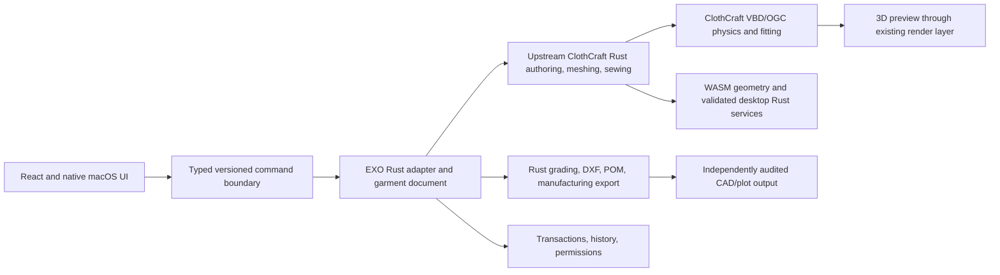

# EXO → Rust/ClothCraft engineering roadmap, ordered by impact and dependencies

**Source baseline:** GitHub EXO `985bc9a8e5031a9fa02666a44390802aff8e04ce`. This is a **proposed engineering delivery plan**, not 41 completed features, paid sprint dates or an active upstream assignment list. See [all 41 system-by-system definitions](SYSTEM_PLANS.md), [dependency-ranked board](TASK_BOARD.md) and [actual code composition](CODE_DASHBOARD.md).

## Guiding architecture

**Design constraint:** React, CSS, Swift/WKWebView and optional egui/wgpu remain legitimate UI/OS layers. Migrate *engineering math, canonical document ownership, mutation/validation, serialization and simulation* to shared Rust crates first. A desktop UI rewrite is a late, separately proven decision, not the definition of Rust engine progress. Maintain one authoritative document/edge/size ID scheme; no shared mutable mirror of JS and Rust project state.

## Why this sequence wins

| Priority | Systems | Outcome that unlocks the next stage | Do not start until |
|---|---:|---|---|
| **P0 — Source, contracts and safety** | 4 | Pinned upstream, canonical Rust document, typed RPC and transactional persistence | Source/rights baseline recorded; tests isolate installed personal app |
| **P1 — Pattern engineering** | 12 | One real six-size tee can be drafted, graded, sewn, tessellated and exported through Rust-backed commands | P0 document and API invariants pass |
| **P2 — Physics, factory and bridge** | 15 | CPU/GPU/contact telemetry, fitting, marker, DXF plot and technical package output linked to one revision | P1 IDs, seam mesh, measurements and units pass |
| **P3 — Advanced systems and optional Rust UI** | 10 | AI, collaboration, materials, costing and optional egui replacement consume validated Rust core | Safety gates and dependencies from P0–P2 pass |

The 41 tasks are ranked according to actual dependencies. Percentage of Rust source is a research signal, **not** the priority algorithm: e.g. project document ownership at 1.6% Rust is more urgent than a visually complete shader because no downstream subsystem can be correct without stable IDs.

## P0: first four PRs (blockers for all other work)

### P0.1 — `EXO-RUST-037` Pin, isolate and test clean upstream compatibility

**Scope:** `research/oss/clothcraft`, `rust/`, `integrations/clothcraft`, new EXO adapter crate only with reviewed allowed path list. **Ownership:** EXO-only adapter branch; upstream patch requires its own accepted claim. **Today:** upstream-derived Rust is already present, but a local EXO-specific modified checkout is not proof that the pristine upstream build matches the installed solver.

- Record **two distinct SHA identities**: clean official upstream HEAD at contribution time and the EXO source revision. Preserve MIT/license notices and do not replace upstream files with unreviewed EXO copies.
- Create a narrow adapter crate and explicit native/WASM feature-selection matrix. No hidden fallback to JS geometry when Rust is reported ready.
- Tests: upstream clean `cargo test --locked --no-default-features -j 2 -- --test-threads=2`; EXO adapter compile and `ExoGarment` fixture identity/units test; missing-native/ABI version mismatches fail closed.
- **Deliverable:** one dependency-lock change, a self-contained test fixture, source-hash report and PR; no user projects or restricted media.

### P0.2 — `EXO-RUST-001` Establish a single versioned garment document

**Scope:** `src/data/defaultProject.js`, `src/core/project.js`, `native_cpp/core/garment_document.cpp`, upstream `project.rs` *read only until approved*, new Rust adapter/schema. **Boundary:** a Rust `ExoGarmentV2` model with piece, edge, seam, notch, POM, grade and material IDs, stable revision, SI internal units plus explicit millimetre import/export adapter.

- First PR is **read-only** conversion of an existing tee snapshot to Rust and back without mutation. Report every dropped/unknown field before accepting edits; forward schema versions reject without data loss.
- Target fixtures: tee front/back, partial seam/notch, two sizes with distinct controls, a legacy project and a deliberately corrupted future-version file.
- **Gate:** roundtrip stable IDs, hashes of untouched geometry/metadata and measured physical dimensions; no silently dropped manufacturing fields. Later, make Rust the sole mutation authority.

### P0.3 — `EXO-RUST-033` Replace ambiguous transport with typed, authenticated Rust commands

**Scope:** `integrations/clothcraft/server.mjs`, agent/API adapters, native Rust session and service APIs. React remains a caller; Node may remain as a static hosting/platform shim until parity.

- Define `CommandEnvelope {schema_version, project_revision, command_id, actor_scope, payload}` and structured success/error contracts, including deterministic response codes for malformed units, missing IDs, stale revision, unavailable solver and unauthorized access.
- First PR: shadow an existing `snapshot` + one no-op-safe `set-measurement` command to Rust without altering production ownership. Trace source SHA and actual executable fingerprint.
- **Gate:** positive plus unauthorized 401/origin rejection, concurrency/stale revision, timeout, process restart, old bridge compatibility and native standalone service negative tests. Do not imply successful RPC means physical fit is calibrated.

### P0.4 — `EXO-RUST-029` Crash-safe edit journal and Undo/Redo

**Scope:** `src/core/project.js` and relevant history/persistence modules plus Rust document commands. Preserve React command labels and UI history appearance; Rust owns all committed state transitions.

- First PR: one curve control-point move as an atomic Rust edit with `before/after`, monotonic revision, stable edge ID, reversible Undo/Redo and deterministic serialized form.
- **Gate:** UI edit → Save → close new isolated app → reopen → Undo/Redo → export at same geometry and IDs. Inject interrupted save, stale parent revision, two writers and invalid numeric values; all must reject without partial state.
- A basic `save` HTTP 200 from a staging app does **not** satisfy this acceptance; detailed project persistence parity remains open.

## P1: prove one complete Rust-backed 2D garment pipeline

Start with one **neutral-license** tee fixture, named sizes XS–XXL (distinct graded controls, not six identical copies), linked left/right seams and explicit measurement targets. For every PR, keep a trusted JS/C++ reference until independent Rust parity passes.

| Sequence | ID | Concrete first delivery | Authoritative boundary and verification |
|---:|---|---|---|
| 05 | [003](SYSTEM_PLANS.md#sys-03) | Rust Bézier control/arc-length/tangent/offset function | Compare numerical independent fixture, self-intersection, reversed winding, nonfinite input and fixed ID mapping; target precision thresholds must be approved, not guessed. |
| 06 | [005](SYSTEM_PLANS.md#sys-05) | Rust parametric DAG for sleeve/armhole relationship | Cycle, orphan target, mixed-unit and cross-piece invalidation tests; existing React redraw follows Rust result. |
| 07 | [007](SYSTEM_PLANS.md#sys-07) | One typed POM formula for every named tee size | Curved control points, size-specific POM table, missing reference and conversion tests. |
| 08 | [002](SYSTEM_PLANS.md#sys-02) | One Rust snap/ruler command from actual 2D UI | Multi-DPI pointer coordinate and zoom cases; same material result, no duplicate JS geometry authority. |
| 09 | [004](SYSTEM_PLANS.md#sys-04) | Atomic curved split/mirror | Preserved notch/seam IDs, reflection parity, nonmanifold rejection, Undo/Reopen. |
| 10 | [006](SYSTEM_PLANS.md#sys-06) | Full six-size tee grading from Rust | Per-size Bézier controls, nonuniform points, named rules and 24-size stress; real editor readback and cold reopen. |
| 11 | [010](SYSTEM_PLANS.md#sys-10) | Persistent allowance/cutline/notch operation | Edge-linked offsets and corner handling; physical 100-mm print and negative overlap tests. |
| 12 | [008](SYSTEM_PLANS.md#sys-08) | Rust paired partial-seam command | Directed intervals, length tolerances, remesh anchor, graded seam link and bad-match rejection. |
| 13 | [011](SYSTEM_PLANS.md#sys-11) | Deterministic stitched tee mesh | Mesh area/winding/UV/grain/source edge IDs, quality and orphan-seam checks. |
| 14 | [016](SYSTEM_PLANS.md#sys-16) | Shared physical fabric property schema | Density, warp/weft, bending, stretch, thickness and friction with unit and cache-invalidation tests. |
| 15 | [023](SYSTEM_PLANS.md#sys-23) | Tee DXF import/export in industrial dialect | Units, curves, notches, grain, six sizes and external-reader comparison (generic DXF import alone is not AAMA/ASTM parity). |
| 16 | [015](SYSTEM_PLANS.md#sys-15) | Licensed neutral avatar shape and pose record | Scale/normals, landmarks, collision proxy and swept motion with no private avatar export. |

**P1 release gate:** Given the same pinned project revision, independently reconstruct the six-size tee's 2D measurements and sewn mesh; save/reopen and export DXF without ID, seam or allowance drift. Run a real AppKit/WebKit/UI command path test, not merely unit tests. All failures and unsupported industrial dialects must be stated explicitly.

## P2: simulation and factory evidence (do not confuse screenshots with validation)

- **17–19: physics/contact/drape (`012`, `013`, `014`)**: compare CPU Newton control vs selected upstream VBD/OGC mode; fix solver feature provenance, complete step time, contact distances and cloth/cloth plus cloth/body penetration; record multiple moving poses and persistent convergence. GPU tests opt-in on authorized machine, not default CI. Measure energy/strain and residual drift; **no automatic real-world fit approval**.
- **20–22: marker/plot/factory preflight (`022`, `024`, `025`)**: marker source grain/width/size ratios; generated physical SVG/PDF/PLOT; independent 100-mm ruler, AAMA/DXF viewer and negative cutter preflight. An invalid factory package **must not** be labeled production ready.
- **23–26: techpack, trims, darts, exports (`027`, `018`, `009`, `021`)**: BOM/POM on the same document SHA; hardware anchors and dart transfer survive graded panel regeneration; canonical mesh OBJ/glTF with exported metric scale and UV. License-check trims and images; no proprietary CLO3D uploads.
- **27–31: library/reference, workspace tools, AI-safe collaboration, optional Rust-native editor (`030`, `039`, `031`, `034`, `036`)**: versioned, source-verified records with permission/revision checks, calibrated photo digitizing and typed command routing. If egui prototype is started, preserve the working React/Swift interface until screenshot, keyboard, pointer and save/undo parity pass.

**P2 gate:** one full edit→grade→sew→simulate→inspect→DXF/plot/techpack→reopen workflow, tested under stale revision, permission-denied and invalid industrial export conditions. Ship only redacted source evidence and public-license fixtures. Test upstream original separately.

## P3: advanced modules after the shared Rust core works

- Fabric visual/PBR, foam/trapunto, print/embroidery and factory costs (`017`, `020`, `019`, `028`): Rust canonical parameter data; keep presentation rendering in existing frontend or shared wgpu where proven. Make visual-only edits avoid solver resets.
- Advanced factory packages (`026`): all outputs revision-locked with size marker quantities, consistent manifest checksums and external receiver validation.
- AI agent (`032`): typed approve-before-apply Rust capability API; reject malicious/unbounded generation and unauthorized file writes.
- Diagnostics and uncategorized JS (`035`, `038`, `041`): performance traces and file-by-file ownership registry, not unreviewed bulk file deletion or guessed Rust mapping.
- macOS lifecycle (`040`): optional native egui/wgpu UI after core parity. Use an independently signed and notarized staging candidate with rollback/clean Mac, no replacement of active installed EXO until approved.

## Weekly execution playbook for human and AI contributors

1. **Select one** board ID and read its full source examples, dependencies and acceptance tests. Confirm the upstream issue isn't owned by someone else.
2. On an EXO branch, write a failure-reproducing test/fixture first; request upstream claim/acceptance **only if editing upstream ClothCraft**.
3. Implement the smallest Rust function or typed command; keep a JS/C++ shadow path and compare outputs. Never silently change units/IDs or use screen visuals as numerical proof.
4. Execute focused Rust unit tests and non-GPU native/wasm tests, then a real isolated EXO AppKit command path and reopen test where applicable.
5. Report `source SHA`, `binary SHA`, `fixture SHA`, `command`, `observed output`, `negative cases`, `limitations`, and `reviewer`. A test not run is not a pass.
6. Open a focused PR; record file scopes, upstream links, regression delta and handoff. Do not mark a task `done` until reviewed runtime evidence and merge confirm it.
7. Regenerate dashboard after a reviewed merge using its new immutable Git SHA. Do not cherry-pick old percentages into the new denominator.

## First sprint acceptance checklist (proposed, not executed)

- [ ] Clean pinned upstream ClothCraft baseline test log and corresponding source/attribution review.
- [ ] Versioned Rust garment-document API with neutral tee fixture and stable IDs.
- [ ] Typed Rust command envelope with denied-origin/stale-revision negative tests.
- [ ] One measured geometry edit + deterministic Undo/Redo + save/reopen under isolated EXO staging.
- [ ] Source-built native desktop/WASM test fixture and provenance hashes; working original installation untouched.
- [ ] EXO PR and upstream task discussion clearly separated, with explicit acceptance and handoff.

Read [the 41-system board](TASK_BOARD.md) for dependency-ordered tasks and [upstream rules](RESEARCH_AND_COORDINATION.md) before assigning agents.
