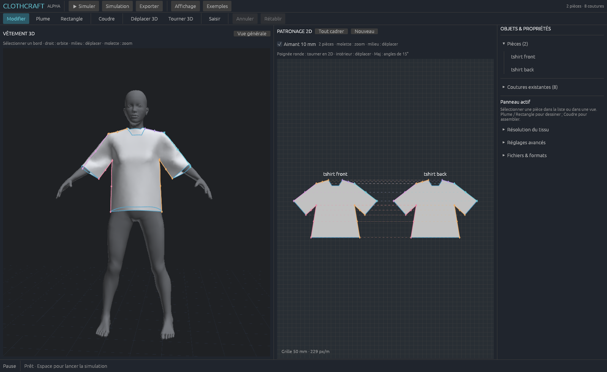

# ClothCraft


**Draw patterns. Sew pieces. Build better cloth physics.**

ClothCraft is an early native Rust experiment in garment authoring and cloth simulation. It is intended to become an editing foundation on which humans and AI contributors can develop, compare and replace physics solvers.

> **Very early alpha. Almost everything needed for a production garment tool is still to be built.** The drawing, sewing and simulation loop is a working prototype, not a CLO or Marvelous Designer replacement. Expect missing tools, rough edges and cases that do not simulate well.

[Contributor entry point](AI_START_HERE.md) · [Roadmap](ROADMAP.md) · [Editing guide](docs/authoring.md) · [Import/export plan](docs/interoperability.md) · [Solver challenge](docs/solver-challenge.md)



## Behavioral target

ClothCraft independently targets the core pattern-based garment workflow of [Marvelous Designer](https://www.marvelousdesigner.com/): draw material-space 2D pieces, connect their boundaries with seams, arrange them around a 3D avatar, and simulate the assembled cloth. The [public-manual study](docs/manual-study.md) records the behaviors studied, what is implemented, and the next acceptance cases in the [roadmap](ROADMAP.md).

Compatibility is currently **targeting**, not verified parity. Native Marvelous Designer / CLO project and garment files are unsupported; matching their simulation results, full toolset or proprietary implementation is not claimed. ClothCraft uses its own document formats and physics implementation. The interface is English, and Windows is the only locally exercised desktop platform.

## What works today

- Numeric point editing, multi-point selection, exact boundary splits and target lengths; camera presets, orthographic view and light/dark themes. [Integration notes and contributor credit](docs/firefly-integration.md).
- One metric 2D board: rectangles, polygon/Bézier drafting, anchor/handle editing, translation and rotation.
- Linked panel/boundary selection in 2D and 3D; whole-edge sewing, reversal, explicit easing, seam deletion and undo/redo.
- Colored seam correspondences in both views, including previews before committing a seam.
- Numeric rectangles, circles/ellipses and arc sectors; independent X/Y mirror copies; union, intersection and subtraction with holes.
- Editable internal Bézier sewing lines and gathered strips attached with the existing seam model. See [drafting tools and limits](docs/drafting-tools.md).
- 3D arrangement gizmos and numeric transforms; mouse grabbing during simulation.
- Constrained Delaunay meshing, material-space rest geometry and per-panel grain direction.
- Nine indicative fabric presets with mass, thickness, stretch, shear and bending controls. Mechanical values are **estimates**, not calibrated measurements; see [fabric sources](docs/fabrics.md).
- CPU Newton reference, CPU VBD and hybrid GPU VBD with Offset Geometric Contact. Contact detection remains CPU. There is **no solver plugin API** yet.
- Editable JSON projects/templates, static garment OBJ export, avatar OBJ import and preview SVG export.

The T-shirt, dress and bundled CC0 MakeHuman avatar are engineering fixtures, not production patterns.

## Run the workspace

Install a stable Rust toolchain and a platform C/C++ linker. The desktop build needs a GPU/driver supported by wgpu. Windows + RTX 3090/Vulkan is the locally exercised configuration; other desktop platforms are not release-qualified.

```powershell
git clone https://github.com/erythrofr/ClothCraft.git
cd ClothCraft
.\scripts\start-atelier.ps1
```

Equivalent command:

```sh
cargo run --release --locked -j 2 --bin cloth-fit -- --steps 0 --view --output output/my-session
```

The window starts paused. The current UI labels are English:

| Action | Control |
|---|---|
| Draw | **Pen**: click corners, drag for Bézier handles; **Rectangle**: drag opposite corners |
| Add a primitive | **Shapes**: dimensions in mm, circle/ellipse or closed arc sector |
| Mirror / boolean | Select a piece → **Mirrors and booleans**; overlap A/B on the 2D board |
| Add a ruffle | **Ligne intérieure** → click/drag inside the selected piece → Enter → **Create and sew a ruffle** |
| Edit / rotate in 2D | **Edit**: select a piece, edit points or drag its round rotation handle |
| Sew | **Sew**: choose edge A and B in either view, inspect direction, then validate |
| Move / rotate in 3D | **Move 3D (G)** / **Rotate 3D (R)**; Shift snaps to 15° |
| Simulate / pause | **Simulate** or Space; **Grab** lets you drag the simulated cloth |
| Remove a seam | Select its edge, **Delete seam** or Delete; Ctrl+Z restores it |
| Navigate | Right-drag orbits 3D, middle-drag pans, wheel zooms; **Overview** / **Frame all** frame the views |
| Save / export | **Export** writes the project and supported artifacts to the session directory |

**3D arrangement returns the selected piece to its flat pattern shape.** Other pieces retain their drape. A 2D layout edit preserves the entire physical state. Neither operation repairs intersections; place pieces outside the avatar before simulating.

Export replaces fixed filenames in the chosen output directory. Use a separate directory per session. There is no autosave, recovery system or file picker yet.

```powershell
.\scripts\start-atelier.ps1 -ProjectPath output/my-session/fitting-project.json
```

Projects contain an avatar path that may need relinking on another computer. See the [complete workflow](docs/authoring.md).

## Files you can actually exchange

| Data | Input now | Output now |
|---|---|---|
| Editable garment and saved state | ClothCraft fitting-project JSON via CLI | `fitting-project.json` |
| Editable patterns | ClothCraft template JSON via CLI | `template.json` |
| Static 3D geometry | Avatar OBJ, geometry only | `cloth.obj`, grouped by piece, local metric UVs |
| Pattern preview | — | `patterns.svg`, **not a print-to-scale sewing pattern** |
| Research diagnostics | — | Fiber-frame JSON and grain-guide OBJ; no explicit yarn mechanics |

**DXF-AAMA/ASTM, MTL, glTF/GLB, Alembic, USD, FBX, PDF printing, grading rules and other industry adapters are not implemented.** A mesh does not recover editable sewing patterns. See [direction-specific priorities and acceptance criteria](docs/interoperability.md).

## Help build it

Start with [AI_START_HERE.md](AI_START_HERE.md), [AGENTS.md](AGENTS.md), [the handoff](docs/handoff.md) and [CONTRIBUTING.md](CONTRIBUTING.md). Pick a small, verifiable milestone from the [roadmap](ROADMAP.md). Leave reproducible fixtures, tests and an honest account of what remains unsupported.

If you want to experiment with a faster or more accurate solver: please do. Keep the same scenes, materials, mesh resolution and physical time step, and report both quality and full-step cost. Frame rate alone is not evidence of correct cloth motion. The [solver challenge](docs/solver-challenge.md) defines the comparison contract.

The authoring model is independent of egui/wgpu. Replacing physics should not require replacing garment documents, sewing identities or import/export tools. A common backend lifecycle and capability interface still needs to be designed and exercised by real adapters.

## Validate without a GPU

```powershell
.\scripts\check-cpu.ps1
```

```sh
cargo test --locked --no-default-features -j 2 -- --test-threads=2
cargo clippy --locked --no-default-features --all-targets -j 2 -- -D warnings
cargo build --locked -j 2
```

The last command only compiles. GPU tests and native window checks are opt-in; coordinate GPU use with the machine's owner. CPU tests cover energy derivatives, rest/mass invariants, seams, meshing, contact bounds and editing state. See [workspace checks](docs/workspace-polish.md) for this UI/performance pass.

## Physics and performance limits

VBD/OGC is hybrid, with finite iteration budgets, penalty seams and local collision exclusions at sewn correspondences. It requires an initially separated state. Friction, animated avatars, robust multilayer workflows, measured fabric calibration and production seam closure are still missing. The 3D grid is not a physical floor. Remeshing resets affected geometry instead of transferring a drape.

Previous local measurements reached about 60 UI frames/s and 60 physical steps/s on a T-shirt, while the apron scene remained around 50 physical steps/s. These are **scene-specific historical results**, not a universal realtime guarantee. This pass optimizes editor interaction and board rendering; it does not claim a faster physical solver. Read [jitter measurements](docs/jitter.md), [adaptive initialization](docs/adaptive-initialization.md), [OGC contracts](docs/ogc.md) and [performance evidence](docs/workspace-polish.md).

## Code map

| Area | Start here |
|---|---|
| Editing transactions / state preservation | `src/authoring.rs`, `tests/editing_state.rs` |
| Pattern board / sewing / workspace | `src/atelier/board.rs`, `edges_3d.rs`, `seam_links.rs`, `workspace.rs` |
| Pattern model / meshing / interchange | `src/garment/`, `docs/architecture.md` |
| FEM / reference physics | `src/model.rs`, `src/energy.rs`, `src/solver.rs` |
| VBD / contact / GPU compute | `src/vbd.rs`, `src/ogc/`, `src/gpu_vbd.rs`, `src/vbd.wgsl` |
| Avatar queries / picking | `src/avatar.rs`, `src/picking.rs` |
| Worker cadence / window measurements | `src/atelier/worker.rs`, `src/atelier/perf.rs` |

## Provenance and licensing

ClothCraft is independent of CLO, Marvelous Designer and ArtCraft. Public manuals and screenshots are workflow references, recorded in the [behavior ledger](docs/manual-study.md); their code, icons, artwork and example garments are not bundled. The original ram icon was generated for this project, inspired by the engraved-animal presentation of ArtCraft's apps; see [artwork provenance and prompts](assets/branding/README.md). This implementation does not claim feature parity or formal clean-room certification.

ClothCraft's original source and documentation are available under the [MIT License](LICENSE). The project artwork is distributed under the same license where applicable; its generation record remains in [artwork provenance](assets/branding/README.md). The bundled MakeHuman assets retain their separate [CC0 notice and provenance](assets/makehuman/LICENSE.ASSETS.md). Third-party dependencies retain their respective licenses.
