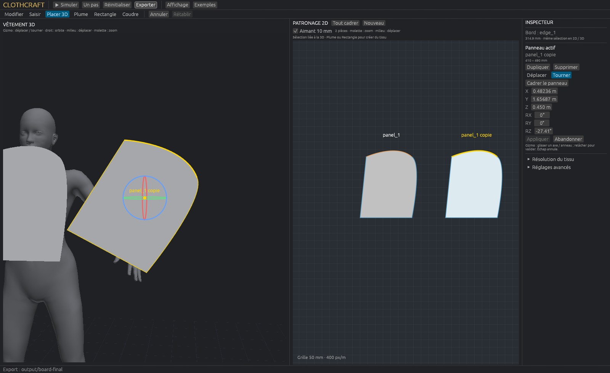

# Unified board validation — 2026-10-14

Historical report before the GPU inertial-prediction fix. Current motion, sewing workflow and performance limits are recorded in [apron validation](apron-validation.md); the old realtime figures do not validate the corrected dynamics.

A real native-window run exercises the new drafting workflow; the screenshots below are application captures. Local host: Windows, RTX 3090 / Vulkan, Rust 1.97.1. Ordinary checks remain CPU-only, two jobs/threads. Machine-readable results: [board-validation.json](board-validation.json).

## CPU and build

- **68 CPU tests passed** with `scripts/check-cpu.ps1`: physical derivatives/contact invariants plus the authoring and new board/curve tests.
- Rustfmt, CPU Clippy and desktop Clippy with `-D warnings` passed; release `cloth-fit` built.
- Five template fixtures validated, including [curved-panels.json](../examples/templates/curved-panels.json), saved from the native workflow (946 vertices / 1,710 triangles / 2 panels / 1 seam).
- The first publication's Linux CI passed its 63 tests but failed on Rust 1.99's new `chunks_exact_to_as_chunks` lint. The indicated test expression is corrected here without changing its assertion; its 11-test suite was rerun locally. Check GitHub Actions for the current commit's Linux result.

New properties: curve-to-chord error bounded against dense cubic samples, collinear overshoot retained, semantic edge identity/length/mass retained through remeshing, exact JSON round-trip topology, atomic rejection of incompatible sewing edits, and 2D layout changes preserving physical cache/state. Rebasing an edited contour preserves untouched world anchors.

## Thirty native pointer actions

`--ui-authoring-smoke` injects egui press/move/release events into the actual widgets. All **30 actions passed**: rectangle creation, replacement with a curved pen contour, handle and anchor editing, 2D layout drag with unchanged physics/state, translation, duplication, one boundary picked in 2D and the other in 3D, sewing, undo/redo, rotation and export/reload/compile. Reports assert resulting document changes, not only that a click was sent.



The independent `--ui-interaction-smoke` picked the simulated T-shirt, accepted a solver step with the mouse attachment and measured 10.78 mm maximum vertex displacement. This verifies interaction, not a force-calibration result.

The saved curved fixture also completed **60 GPU simulation steps** at dt=1/60 s and 8 iterations. Mean full step: 4.30 ms. Its deliberately separated and rotated pieces still have a **406 mm maximum seam gap** at 1 s: this is an integration smoke, not a successful garment fit or convergence benchmark.

## Realtime regression sample

The existing T-shirt snapshot at 6 s was reopened, 2,454 vertices / 4,570 triangles, 25 mm target edge size, 8 iterations. No concurrent build or second simulation during this measurement. After one second warmup, five seconds of actual window cadence:

| Measure | Result |
|---|---:|
| UI frames/s | 59.98 |
| Delivered physics steps/s | 59.78 |
| Simulated time / wall time | 0.996× |
| Frame-interval P95 | 17.92 ms |

This is a short local regression check, not a guarantee for larger garments or arbitrary edits. The physics engine is unchanged in this editor pass. [Turbo methodology](turbo-perf.md) explains the existing hybrid solver and limits.

## Reproduce

```powershell
.\scripts\check-cpu.ps1
cargo clippy --locked --all-targets -j 2 -- -D warnings
cargo build --release --locked -j 2 --bin cloth-fit
.\target\release\cloth-fit.exe --steps 0 --ui-authoring-smoke --output output/board-final
.\target\release\cloth-fit.exe --project output/board-final/fitting-project.json --gpu-sim --steps 60 --threads 2 --output output/board-sim
```

The last two commands explicitly use the GPU and are outside CPU CI. For the T-shirt performance snapshot, `scripts/turbo-perf.ps1 -Steps 360 -MeshMm 25 -UiPerf` regenerates the standard fixtures. Then run:

```powershell
.\target\release\cloth-fit.exe --project output/turbo-repro/tshirt/fitting-project.json --steps 0 --ui-perf-smoke --output output/board-perf
.\target\release\cloth-fit.exe --project output/turbo-repro/tshirt/fitting-project.json --steps 0 --ui-interaction-smoke --output output/board-grab
```

Current editor boundaries: whole named-edge sewing, no holes, no internal cuts, no multi-selection, no exact algebraic curve-intersection proof. Highlights are overlays while 3D picking tests visibility. The fixture is authored in ClothCraft and contains no copied third-party pattern.
